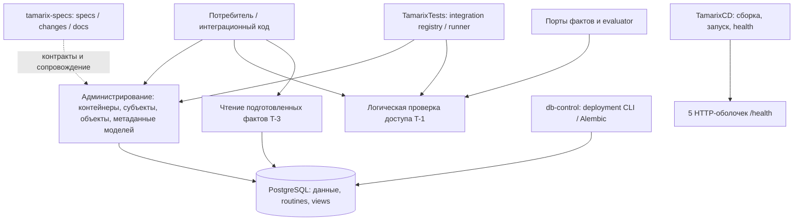

# Как устроен Tamarix

Tamarix — основа системы управления доступом к ресурсам. Она хранит
иерархию контейнеров, субъектов, объектов и моделей доступа, проверяет область
административных действий и содержит логическое ядро вычисления доступа.
Контейнер задаёт область организации данных; субъект — того, кому нужен доступ;
объект — защищаемый ресурс; модель — правила принятия решения.

Руководство описывает проверенный по исходникам срез **15 октября 2026 года**
после T-3-persistent. Актуальность следующих изменений поддерживается при archive.
Состояние работающего deployment нужно проверять отдельно по его manifest.

## Маршрут первого знакомства

| Порядок | Раздел | На какой вопрос отвечает |
| --- | --- | --- |
| 1 | [Архитектура](architecture.md) | Как связаны части продукта, какие слои выполняют работу и где границы готовности? |
| 2 | [Домены и словарь](domains.md) | Что означают O, C, D, держатель, модель и полный состав цепочки? |
| 3 | [Сервисы](services.md) | Кто отвечает за каждую операцию и как части взаимодействуют? |
| 4 | [API и примеры](api.md) | Какие интерфейсы реально можно вызвать и какие результаты они возвращают? |
| 5 | [База данных](database.md) | Где данные, какие таблицы и связи, зачем ограничения, индексы и блокировки? |
| 6 | [Эксплуатация](operations.md) | Как подготовить среду, запустить сервисы, проверить готовность и разобрать сбой? |
| 7 | [Разработка и archive](development.md) | Как менять систему, проверять требования и поддерживать руководство? |

После обзора пройдите пример с `Acme / Prod / Orders` из
[доменов](domains.md) и сопоставьте его с данными в [справочнике БД](database.md).

## Общая схема

Стрелки обозначают фактические виды взаимодействия. Они не утверждают наличие
сетевого REST-вызова между сервисами. В текущем runtime HTTP обслуживает
`GET /health`; бизнес-операции T-3 доступны как синхронные Python-интерфейсы.

## Что уже есть

| Область | Реализовано | Граница |
| --- | --- | --- |
| T-1 | Ядра пяти сервисов, дерево, допуск вызывающего, держатели, правила ссылок и агрегация доступа | Источники фактов и evaluator передаются через порты; это не готовая PKI или policy engine |
| T-3 | PostgreSQL forest, типизированные атрибуты/DN, CRUD в принятом scope, CAS/revision, soft delete/restore субъекта, метаданные моделей, snapshot reader | Внутреннее содержимое моделей, исполняемые правила, actions/privileges и persistent PDP ещё не подключены |
| Доставка | Пять Docker-контейнеров с health, фиксированные снимки Git; отдельная disposable PostgreSQL-среда для integration | HTTP health не подтверждает операции БД или доступ субъекта |
| Проверка | Межсервисный registry/runner, отчёты, promotion, archive gate | Последний архивный PASS относится к записанным версиям и scope |
| Назначения | Существует `access-assignment-api/openspec/config.yaml` | Прикладной код и контракты назначений пока отсутствуют |

T-3 архив содержит [итог 101/101 PASS](../openspec/changes/archive/2026-10-15-t-3-persistent/README.md).
Это историческое evidence; создание этого руководства не запускает и не повторяет
предметные тесты.

## Где искать первоисточник

| Источник | Назначение |
| --- | --- |
| [Основные specs](../openspec/specs/) | Текущее нормативное поведение capabilities |
| [Контекст и ADR](../openspec/context/README.md) | Пользовательские решения, ограничения проектирования и история |
| [Архив T-3](../openspec/changes/archive/2026-10-15-t-3-persistent/README.md) | Обоснование persistence и зафиксированные проверки |
| [db-control](../../db-control/README.md) | Исполняемые миграции, routines и deployment interface |
| [TamarixCD](../../../TamarixCD/README.md) | Сборка и среда запуска |
| [TamarixTests](../../../TamarixTests/README.md) | Реальные команды тестов и формат результатов |

Соседние ссылки предполагают checkout вида `TamarixS/Tamarix/{tamarix-specs,
...сервисы}`, `TamarixS/TamarixCD`, `TamarixS/TamarixTests`.
Store можно читать отдельно; ссылки на исходники потребуют соседних репозиториев.

Документация объясняет реализацию; specs задают требования. Обнаруженное
расхождение нужно оформить change и исправить, не превращая описание кода
в новое утверждённое бизнес-правило. В старом context сохранены датированные
наблюдения T-1: для текущего устройства используйте это руководство и код.
