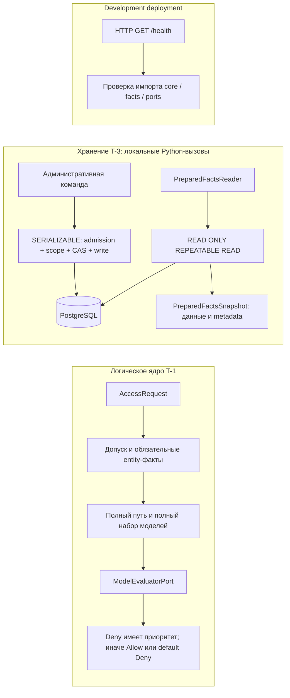
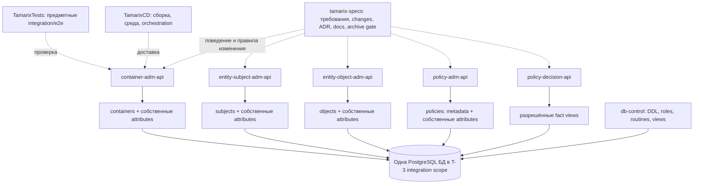
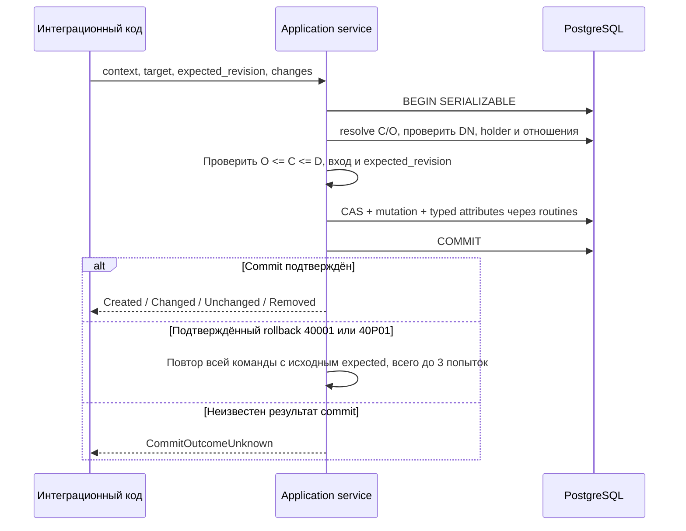

# Архитектура и границы системы

[Начало](README.md) · [Домены](domains.md) · [Сервисы](services.md) · [База данных](database.md)

## Задача продукта

Tamarix отделяет управление данными доступа от вычисления решения для субъекта.
Владелец контейнера может администрировать данные своего поддерева. Проверка
доступа использует субъект, объект, действие и модели по всей ветке объекта.
Право администратора изменять модель само по себе не даёт субъекту доступ.

Единицей области служит контейнер с типом `organization`, `environment`,
`system` или `module`. Субъект, объект и модель принадлежат одному держателю.
Общие каталоги типов субъектов и определений атрибутов управляются отдельно.
Подробные инварианты и пример предметной области — в [domains.md](domains.md).

## Три разных контура исполнения

T-1 вычисляет решение на переданных через порты фактах и evaluator. T-3 даёт
постоянное хранение и согласованный снимок фактов, но metadata модели недостаточно
для её исполнения. `PreparedFactsSnapshot` не преобразуется в `EvaluatedDecision`
автоматически. HTTP-оболочка не соединяет эти два контура в бизнес endpoint.
Это существенная граница текущей готовности, а не альтернативные способы
вызова уже готового persistent PDP.

## Карта репозиториев и ответственности

T-3 SQL-адаптеры обращаются к одной согласованной схеме хранения через
выделенные PostgreSQL роли и ограниченные routines/views. `db-control`
исполняется при подготовке/миграции и не является HTTP-посредником каждого
предметного запроса. Владение DDL централизовано; бизнес-обязанности остаются
у соответствующих административных сервисов.

Транспорт удалённых бизнес-вызовов и production topology пока не определены.
Схема показывает реализацию кода и integration-среды, не HA deployment.
У `access-assignment-api` пока только store pointer; его нельзя добавлять
в существующий исполняемый поток как готовый сервис.

## Слои внутри пакета

| Слой / файлы | Ответственность | Чего от него не ожидать |
| --- | --- | --- |
| `facts.py`, `address.py` | Значения T-1, typed address, различимые результаты полноты | Сетевая аутентификация, транзакции |
| `ports.py` | Protocol для фактов, репозиториев и evaluator | Реализация транспорта по одному имени порта |
| `core.py` | Дерево, scope, management T-1, сбор/агрегация решения | Независимый commit или DDL |
| `storage_types.py` | Неизменяемые ID/revision, typed attributes, snapshots и outcomes T-3 | HTTP schema и JSON wire contract |
| `persistence.py` | Application commands/readers; владение транзакцией, admission и scope | Хранение произвольного прежнего content |
| `storage_runtime.py` у admin-сервисов | Session/изоляция, mapping ошибок, ограниченный retry | Слепой повтор при неизвестном commit |
| `storage_sql.py` | SQL-вызовы routines/views и материализация локальных DTO | Самостоятельное начало/commit транзакций |
| SQL в `db-control` | DDL, DB-инварианты, права, guards и служебные views | Проверка сертификата или бизнес scope `O ≼ C ≼ D` вместо application |
| `TamarixCD/runtime` | Development process, ASGI/FastAPI health | Готовый business REST API |

Каждый сервис определяет собственные локальные классы. Межпакетные адаптеры
явно переносят type/key/ID; совпадение числа ID или имени Python-класса
не доказывает вид сущности. Общего runtime-пакета доменных типов нет.
Структура реализует разделение правил и адаптеров; весь проект не объявлен
DDD/CQRS/event sourcing или другим выбранным стилем по этому сходству.

## Путь административного изменения

DB проверяет форму и целостность записи; application проверяет доверенного
вызывающего и область. Guard и CAS нужны вместе: revision предотвращает запись
с устаревшим представлением агрегата, а guards сериализуют конкуренцию
за ключи, lifecycle и определения. Детали блокировок/ограничений —
в [database.md](database.md).

## Доверие, данные и актуальность

`VerifiedCertificateFact` означает факт от доверенной внешней границы.
Создание DTO не выполняет проверку цепочки сертификата, подписи, срока или
отзыва. T-3 сравнивает Name DER с DN-атрибутом явно представляемого O и
настроенным trusted definition ID. Production PKI/mTLS и размещение PEP/PIP
требуют отдельного решения.

Snapshot reader использует одну read-only repeatable-read транзакцию.
Полученные факты согласованы внутри этого чтения; последующий отзыв DN или
изменение модели не делает уже выданный DTO «живым». Срок допустимого отзыва,
связь решения с защищаемой операцией, кэширование и аудит ещё не определены.

## Технологии и ограничения

Набор в текущих манифестах: Python 3.15.0, uv/uv_build 0.12.24,
SQLAlchemy 2.1.4, Psycopg 3.3.6, Alembic 1.20.0; CD runtime использует
FastAPI 0.143.0 и Uvicorn 0.53.0. Это локальные pins реализации,
не утверждение о последних доступных релизах. Источники:
[container pyproject](../../container-adm-api/pyproject.toml),
[db-control pyproject](../../db-control/pyproject.toml),
[runtime pyproject](../../../TamarixCD/runtime/pyproject.toml).
PostgreSQL integration фиксирует образ и наблюдаемые server facts в manifest.

Пока отсутствуют persistent содержимое/движок моделей и refs cleanup,
предметный HTTP API и AuthZEN conformance, реализованные назначения,
production trust/HA/SLO/аудит. Эти пробелы нужно учитывать при интеграции,
а не достраивать по названиям сервисов.

Источники архитектуры: [ADR](../openspec/context/adr/README.md),
[контракты T-3](../openspec/changes/archive/2026-10-15-t-3-persistent/storage-contracts.md),
[PDP core](../../policy-decision-api/src/policy_decision_api/core.py),
[PDP persistence](../../policy-decision-api/src/policy_decision_api/persistence.py),
[runtime app](../../../TamarixCD/runtime/src/tamarix_runtime/app.py).
