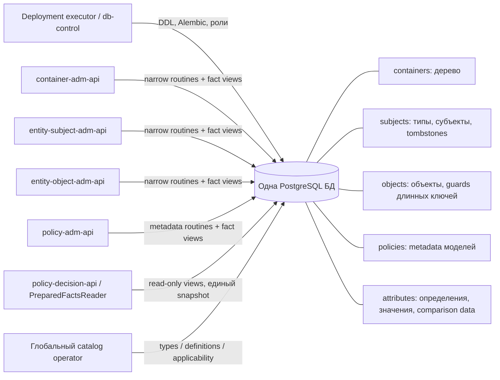
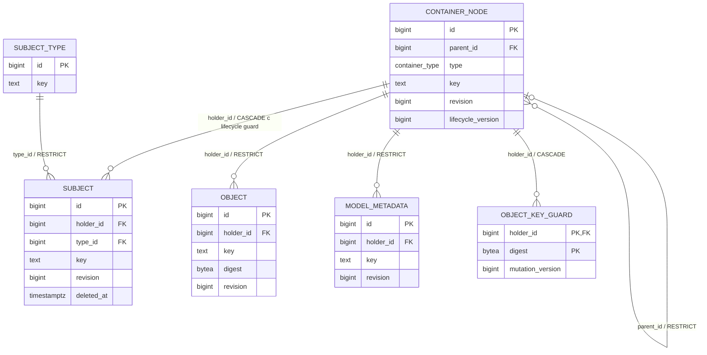
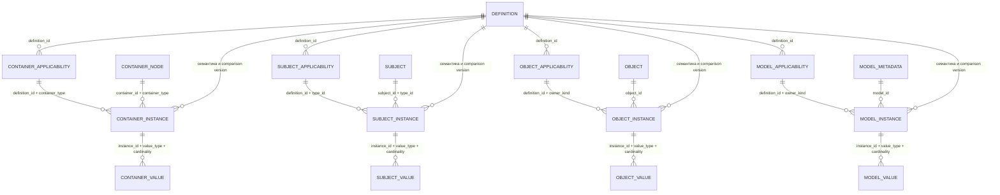
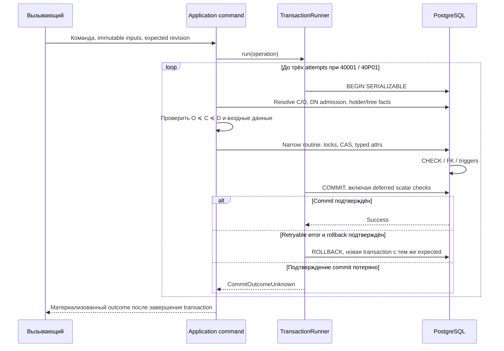

# База данных: от предметной модели к таблицам

Документ описывает реализованную основу хранения T-3 по исходникам на
2026-10-15. Это руководство по схеме, а не снимок production: рабочая БД и её
данные при подготовке документа не исследовались. Все примеры предметных
записей ниже учебные. Наличие таблиц моделей подтверждает хранение metadata,
но ещё не исполнение политики из PostgreSQL.

Для первого знакомства начните с [общей архитектуры](architecture.md), затем
прочитайте разделы о контейнерах, атрибутах и транзакциях здесь. Локальные
Python-контракты описаны в [API](api.md). Реализованный DDL всегда проверяйте
в [db-control](../../db-control/src/db_control/sql/): все изменения схемы,
функций, триггеров, grants и Alembic revisions принадлежат этому репозиторию.

Быстрый переход: [Основные таблицы](#4-таблицы-контейнеров-сущностей-и-metadata) ·
[Атрибуты](#5-атрибуты-definition--applicability--instance--values) ·
[Индексы](#8-индексы-и-стоимость-чтения) ·
[Роли/views](#9-публичная-поверхность-бд-fact-views-и-роли) ·
[Транзакции/locks](#10-транзакции-cas-и-конкурентные-операции) ·
[Данные-пример](#11-сквозной-учебный-пример-данных) ·
[Диагностика](#12-примеры-чтения-и-диагностики) ·
[Миграции](#13-миграции-первичный-root-и-откат).

## 1. Где находятся данные и кто ими управляет

T-3 использует одну PostgreSQL БД с пятью предметными схемами. Физический
владелец объектов — закрытая роль `tamarix_privilege_owner`. Владельцы
предметных операций — соответствующие сервисы; это другой смысл владения.
`db-control` выполняется при поставке и не является посредником runtime-запросов.



| Схема | Реальные таблицы | Назначение |
| --- | --- | --- |
| `containers` | `nodes` | Forest контейнеров, естественные ключи и технический lifecycle fence |
| `subjects` | `types`, `subjects` | Глобальный каталог типов; субъекты с единственным держателем и soft delete |
| `objects` | `objects`, `key_guards` | Защищаемые ресурсы; точная уникальность произвольно длинного ключа |
| `policies` | `models` | ID, держатель, ключ, revision модели; тело и ссылки пока отсутствуют |
| `attributes` | `definitions`, четыре `*_applicability`, четыре `*_instances`, четыре `*_values`, `comparison_implementations`, пять `dn_*` | Типизированные атрибуты и закреплённые реализации равенства |
| `public` | `alembic_version` | Служебная версия миграций; создаётся Alembic, не бизнес-данные |

Всего DDL создаёт 25 таблиц в пяти предметных схемах, дополнительно Alembic
ведёт `public.alembic_version`. Таблиц ролей доступа, назначений, model references,
privileges, actions, аудита, outbox, кэша или `content JSONB` в этой основе нет.
`access-assignment-api` не получает собственную таблицу по одному имени сервиса.
Источники: [foundation](../../db-control/src/db_control/sql/0001_foundation.sql),
[storage](../../db-control/src/db_control/sql/0002_storage.sql),
[DN tables](../../db-control/src/db_control/sql/dn_tables.sql),
[design T-3](../openspec/changes/archive/2026-10-15-t-3-persistent/design.md).

## 2. Основные сущности и их связи



Имена на ER-диаграмме — поясняющие обозначения: `CONTAINER_NODE` соответствует
`containers.nodes`, `SUBJECT_TYPE` — `subjects.types`, `SUBJECT` —
`subjects.subjects`, `OBJECT` — `objects.objects`, `MODEL_METADATA` —
`policies.models`, `OBJECT_KEY_GUARD` — `objects.key_guards`.

У каждого subject, object и model ровно один ненулевой `holder_id`. Контейнер
является держателем, а не владельцем сущности в смысле прав администратора.
Административная область `O ≼ C ≼ D` проверяется сервисом по реальному дереву:
`O` — представляемый контейнер, `C` — адресованный, `D` — держатель данных
либо сам управляемый контейнер. Наличие FK само по себе эту область не проверяет.

В схеме нет мягких ссылок между model и subject/object. Такие ссылки есть в
логических контрактах T-1, но их persistent-хранение и cleanup перенесены за
границу T-3. Текущие связи через `*_id` — физические FK. Вычисляемый адрес,
локальные `ContainerRef(str(id))` и opaque action — значения application-слоя,
а не дополнительные FK или таблицы. См. [storage contracts](../openspec/changes/archive/2026-10-15-t-3-persistent/storage-contracts.md).

## 3. Типы, NULL и общие соглашения

Далее «нет» в столбце NULL означает `NOT NULL`; «—» в default означает, что
значение по умолчанию не задано. Первичные ключи также ненулевые. Все указанные
`id identity` — `BIGINT GENERATED ALWAYS AS IDENTITY PRIMARY KEY`; ID выбирает
PostgreSQL. ID разных таблиц могут совпадать численно, поэтому локальные DTO
различают `ContainerId`, `SubjectId`, `ObjectId`, `ModelId` и другие виды.
Последовательности не обещают непрерывных номеров после rollback.

| PostgreSQL type | Допустимые значения / назначение |
| --- | --- |
| `containers.container_type` | ENUM в порядке `organization`, `environment`, `system`, `module` |
| `attributes.value_type` | ENUM `string`, `integer`, `decimal`, `boolean`, `date`, `instant`, `dn` |
| `attributes.cardinality` | ENUM `single`, `set` |
| `attributes.comparison_profile` | ENUM `exact`, `unicode_ci`, `x509_rfc5280` |
| `attributes.owner_kind` | ENUM `container`, `subject`, `object`, `model`; для функций, не polymorphic owner FK |
| `attributes.value_input` | Composite из семи nullable полей значения; временный вход функции |
| `attributes.change_input` | Composite `(definition_id BIGINT, operation TEXT, values value_input[])`; временный вход функции |
| `attributes.dn_tlv` | Внутренний composite DER decoder `(tag INTEGER, body BYTEA, whole BYTEA, next_offset INTEGER)` |

`TEXT COLLATE "C"` хранит оригинал строки. ASCII CI применяется явной функцией
`containers.ascii_ci`, заменяющей только `A–Z` на `a–z`. Это не Unicode lower.
У subject/object ключей равенство точное, без trim и Unicode normalization.
В прикладных контрактах ID/revision положительны и помещаются в знаковый BIGINT;
`bool`, строки и float вместо ID не принимаются. У всех aggregate revisions
есть SQL `CHECK (revision > 0)`.

## 4. Таблицы контейнеров, сущностей и metadata

### `containers.nodes`

**Назначение.** Хранит узлы контейнерного леса и фактические связи с родителями.
По этим записям строятся адреса контейнеров и проверяются области управления.
На те же узлы ссылаются субъекты, объекты и модели как на своих держателей.

| Столбец | Тип | NULL | Default | Для чего нужен |
| --- | --- | --- | --- | --- |
| `id` | BIGINT identity | нет | генератор | Стабильный ID узла |
| `parent_id` | BIGINT | да | — | FK на `nodes.id`; NULL обозначает корень |
| `type` | `containers.container_type` | нет | — | Тип узла |
| `key` | TEXT COLLATE C | нет | — | Оригинальный ASCII key, 1–255 символов `[A-Za-z0-9_-]` |
| `revision` | BIGINT | нет | 1 | Token логического изменения узла/его attributes |
| `lifecycle_version` | BIGINT | нет | 1 | Технический MVCC fence для создания/удаления содержимого |

FK родителя — `ON DELETE RESTRICT`. Корней может быть несколько; корень не
обязан иметь тип `organization`. При вставке ребёнка DB trigger обновляет
`lifecycle_version` родителя и требует строго большего ранга типа ребёнка.
Пропуски допустимы, например `organization → system → module`. `id`, `parent_id`
и `type` неизменяемы; перемещение узлов этим API не реализовано. Строгое увеличение
типа и неизменяемая структура ограничивают путь четырьмя узлами и исключают новые
циклы через поддерживаемый write path.

Уникальности: PK `id`; `UNIQUE(id,type)` как опора составного FK атрибутов;
частичные unique indexes корня `(type,ascii_ci(key)) WHERE parent_id IS NULL`
и ребёнка `(parent_id,type,ascii_ci(key)) WHERE parent_id IS NOT NULL`.
Следовательно одинаковый `key` разных типов допустим, а `Acme` и `ACME`
одного типа под одним родителем конфликтуют.

Полный адрес не хранится: resolver проходит все фактические сегменты от root.
После rename предка адрес потомка вычисляется иначе, хотя его ID, parent и
собственная revision остаются прежними. Технические lifecycle updates могут
увеличиваться несколько раз за команду из routines/triggers; это не публичный CAS.

### `subjects.types`

**Назначение.** Глобальный каталог типов субъектов. Тип выбирается при создании
субъекта и определяет, какие атрибуты ему разрешено назначать. Каталог позволяет
оператору зарегистрировать тип один раз и использовать его у разных держателей.

| Столбец | Тип | NULL | Default | Назначение |
| --- | --- | --- | --- | --- |
| `id` | BIGINT identity | нет | генератор | ID глобального типа субъекта |
| `key` | TEXT COLLATE C | нет | — | ASCII `[A-Za-z0-9_-]`, 1–512 символов |

`subject_types_key_unique` обеспечивает глобальную ASCII CI уникальность key.
Trigger запрещает изменение ID и key. Тип регистрирует catalog operator;
у него нет holder и aggregate revision. Новый тип не наследует применимость
существующих attributes автоматически.

### `subjects.subjects`

**Назначение.** Хранит идентичность субъекта, его тип, единственного держателя
и состояние удаления. Запись служит владельцем атрибутов субъекта и позволяет
читать и изменять их с проверкой revision, логически удалять субъекта и
восстанавливать его прежний ID вместе с сохранёнными атрибутами.

| Столбец | Тип | NULL | Default | Назначение |
| --- | --- | --- | --- | --- |
| `id` | BIGINT identity | нет | генератор | Стабильная identity субъекта |
| `holder_id` | BIGINT | нет | — | FK на `containers.nodes.id`, `ON DELETE CASCADE` |
| `type_id` | BIGINT | нет | — | FK на `subjects.types.id`, `ON DELETE RESTRICT` |
| `key` | TEXT COLLATE C | нет | — | 1–512 Unicode code points; без Cc/control characters |
| `revision` | BIGINT | нет | 1 | Aggregate CAS |
| `deleted_at` | TIMESTAMPTZ | да | — | NULL — активен; timestamp БД — soft deleted |

`UNIQUE(holder_id,type_id,key)` действует и на tombstones: soft delete не
освобождает имя. `UNIQUE(id,type_id)` нужен составному owner FK атрибутов.
Key чувствителен к регистру: `Alice` и `alice` различны. ID/holder/type/key
неизменяемы. Soft delete сохраняет все поля и attrs, меняя статус и revision;
restore очищает `deleted_at` у прежнего ID. Повтор create по tombstone возвращает
`RestoreRequired`, а не создаёт нового субъекта.

Прямого runtime physical delete субъекта нет. Trigger запрещает физическое
удаление активной строки. Удаление держателя допускает CASCADE только оставшихся
tombstones, вместе с их атрибутами; параллельный restore согласуется lifecycle
fence. Активные fact views скрывают и tombstone, и его attributes, административные
views subject-сервиса сохраняют доступ к ним.

### `objects.objects`

**Назначение.** Хранит идентичность защищаемого объекта: держателя, полный ключ
и revision для изменения его атрибутов с CAS. По этим записям создают, находят
и удаляют объекты. Содержимое самого защищаемого ресурса таблица не содержит;
digest помогает искать кандидатов по полному ключу.

| Столбец | Тип | NULL | Default | Назначение |
| --- | --- | --- | --- | --- |
| `id` | BIGINT identity | нет | генератор | Стабильный ID объекта |
| `holder_id` | BIGINT | нет | — | FK на контейнер, `ON DELETE RESTRICT` |
| `key` | TEXT COLLATE C | нет | — | Непустой Unicode key без control characters; прикладного максимума длины нет |
| `digest` | BYTEA | нет | — | 32-байтовый SHA-256 полного UTF8 key; вычисляет INSERT trigger |
| `revision` | BIGINT | нет | 1 | Aggregate CAS |

Все identity-поля неизменяемы. `object_key_candidates(holder_id,digest)` —
неуникальный индекс поиска кандидатов. Точного unique B-tree по длинному TEXT
нет: уникальность `(holder,key)` обеспечивает обязательный DB write path с
guard и полным сравнением `key COLLATE "C"`. Коллизия SHA-256 разных строк
не является identity conflict. При поиске также проверяются digest **и** полный key.
Физическое удаление объекта удаляет его attrs, сохраняя holder и прочие сущности.

### `objects.key_guards`

**Назначение.** Служебные строки для согласования конкурентных вставок объектов
с одинаковыми держателем и digest ключа. Обновление guard упорядочивает проверку
полных ключей в этой группе кандидатов и не позволяет одновременно создать
два объекта с одной естественной идентичностью. Одинаковый digest разных ключей
допустим; строка guard сама по себе не означает наличие объекта.

| Столбец | Тип | NULL | Default | Назначение |
| --- | --- | --- | --- | --- |
| `holder_id` | BIGINT | нет | — | FK на контейнер, `ON DELETE CASCADE`; часть PK |
| `digest` | BYTEA | нет | — | 32 байта; вторая часть PK |
| `mutation_version` | BIGINT | нет | 1 | Положительная техническая версия hash bucket |

`PRIMARY KEY(holder_id,digest)` сериализует конкурирующие вставки в bucket.
`INSERT ... ON CONFLICT DO UPDATE` реально меняет MVCC-версию, затем trigger
сравнивает полные ключи объектов в bucket. Guard может остаться после удаления
последнего объекта; это ожидаемо. Он живёт до удаления holder, чтобы не вводить
гонку удаления/повторного создания guard. Он не означает существование объекта
и не является внешним ключом `objects.objects` на «зарегистрированный hash».

### `policies.models`

**Назначение.** Хранит постоянную идентичность и метаданные модели доступа:
держателя, ключ и revision. Запись позволяет создавать и перечислять модели,
назначать им атрибуты и удалять их метаданные. Исполнимое содержимое модели
в этом хранилище пока не представлено.

| Столбец | Тип | NULL | Default | Назначение |
| --- | --- | --- | --- | --- |
| `id` | BIGINT identity | нет | генератор | ID metadata модели |
| `holder_id` | BIGINT | нет | — | FK на контейнер, `ON DELETE RESTRICT` |
| `key` | TEXT COLLATE C | нет | — | ASCII `[A-Za-z0-9_-]`, 1–512 символов |
| `revision` | BIGINT | нет | 1 | CAS metadata и её attrs |

`models_holder_key_unique(holder_id,ascii_ci(key))` задаёт identity. ID/holder/key
неизменяемы. Тело, правила, privileges, actions, model references и публикация
версий в этой таблице отсутствуют. Полнота `ModelMetadataSet` подтверждает состав
IDs/holders/revisions/attrs, а не `CompleteModelSet` исполнимых моделей T-1.
Удаление metadata каскадно удаляет только собственные attrs; cleanup входящих
model references пока не требуется, поскольку их таблиц/записи ещё нет.

## 5. Атрибуты: definition → applicability → instance → values

Definition задаёт смысл и тип атрибута глобально. Applicability разрешает
использовать его у определённых владельцев. Instance означает, что у конкретного
владельца атрибут присутствует. Values — типизированное значение либо элементы
множества. Четыре физические пары нужны для прямых FK и прав предметных сервисов.



Диаграмма показывает отдельные реальные семейства: `DEFINITION` —
`attributes.definitions`; `CONTAINER_INSTANCE` — `attributes.container_instances`
и аналогично для остальных. Семантические линии definition → instance также
реализованы FK, а не только проверкой Python.

### `attributes.definitions`

**Назначение.** Глобальный каталог определений атрибутов: какой key, тип,
кратность и правила сравнения имеет каждый атрибут. Определение задаёт общую
семантику для всех его экземпляров; БД использует её при проверке записываемых
значений и их равенства. Применимость, назначение владельцу и сами значения
хранятся в отдельных таблицах ниже.

| Столбец | Тип | NULL | Default | Назначение |
| --- | --- | --- | --- | --- |
| `id` | BIGINT identity | нет | генератор | Глобальный ID определения |
| `key` | TEXT COLLATE C | нет | — | Неизменяемый ASCII key, 1–512 `[A-Za-z0-9_-]` |
| `value_type` | `attributes.value_type` | нет | — | Один из семи нативных видов |
| `cardinality` | `attributes.cardinality` | нет | — | `single` или `set` |
| `comparison_profile` | `attributes.comparison_profile` | да | — | Обязателен для string/DN, NULL для прочих |
| `comparison_version` | TEXT COLLATE C | да | — | Непустая версия для string/DN, NULL для прочих |

Профиль string может быть `exact` или `unicode_ci`; DN допускает только
`set` + `x509_rfc5280`. Другие типы не допускают profile/version. Есть global
ASCII CI unique index `definitions_key_unique`, `UNIQUE(id,value_type,cardinality)`
и `UNIQUE(id,comparison_profile,comparison_version)`. Последние два используются
FK экземпляров. ID и key защищены trigger от изменения.

Семантика и версия сравнения удерживаются при любом instance — даже пустом set
и attributes soft-deleted subject. Поэтому изменить `string → integer`, `set → single`
или comparison version используемого определения нельзя. При новой семантике
нужно новое definition и отдельно спроектированный перенос данных. Реестр
`comparison_implementations` проверяется routines; отдельного FK из definitions
в этот реестр нет.

### Почему метаданные повторяются в instances и values

Это намеренная денормализация ради контроля целостности в PostgreSQL.
У трёх уровней хранения разные роли:

| Уровень | Что представляет |
| --- | --- |
| `attributes.definitions` | Общее определение атрибута: key, тип, кратность и правила сравнения |
| `attributes.*_instances` | Наличие атрибута данного определения у конкретного владельца |
| `attributes.*_values` | Типизированные значения конкретного экземпляра |

Отдельный instance позволяет различать отсутствие атрибута и явно заданное
пустое множество: в первом случае instance отсутствует, во втором существует
instance с `cardinality = 'set'` и без строк values.

В instances копируются четыре поля определения: `value_type`, `cardinality`,
`comparison_profile` и `comparison_version`. Источником семантики остаётся
`definitions`: при создании экземпляра `apply_changes` берёт эти поля из
определения, а составные FK требуют их совпадения. Защитные триггеры запрещают
менять семантику существующего instance. Экземпляр не получает независимых
правил или исторической версии определения; фоновая синхронизация копий не нужна.

Повторение полей обеспечивает следующие гарантии:

1. FK `(definition_id,value_type,cardinality)` запрещает экземпляр с типом или
   кратностью, отличающимися от определения. Отдельный FK
   `(definition_id,comparison_profile,comparison_version)` удерживает правила
   сравнения. Структурный FK использует только NOT NULL поля: NULL профиля у
   нестроковых типов не отключает проверку типа и кратности через `MATCH SIMPLE`.
2. `ON UPDATE RESTRICT` у этих FK блокирует изменение используемой семантики
   определения. Защита действует при любом instance, включая пустой set и
   атрибут логически удалённого субъекта. Например, смена `exact` на `unicode_ci`
   могла бы сделать ранее разные элементы множества равными; такое изменение
   требует нового definition и отдельно спроектированного переноса данных.
3. В values повторяются только `value_type` и `cardinality`, связанные составным
   FK с instance. Это позволяет локальному `CHECK` проверять заполненный
   типизированный столбец, а partial unique index — запрещать второе значение
   для `single`. Ровно одно значение на commit дополнительно проверяет deferred
   trigger. Профиль и версию сравнения guard уникальности множества читает
   из instance.

Цена решения — дополнительные поля, составные ключи и индексы. Альтернатива
с хранением метаданных только в definitions потребовала бы получать их через
`JOIN` и переносить соответствующие межтабличные проверки в триггеры или
командный код с отдельной защитой от конкурентных изменений. Сам `JOIN`
обеспечивает чтение, но не заменяет FK, `CHECK` и partial unique index.
Текущая схема использует денормализацию для гарантий БД; ускорение чтения
этим объяснением не предполагается.

Источники: [DDL таблиц и ограничений](../../db-control/src/db_control/sql/0001_foundation.sql),
[создание instances и проверка равенства](../../db-control/src/db_control/sql/0002_storage.sql),
[требование стабильности семантики](../openspec/specs/attributes/spec.md#requirement-стабильность-семантики-используемого-определения).

### Четыре таблицы применимости

**Назначение.** Явно разрешают использование определения у выбранных классов
владельцев. Запись применимости разрешает назначить атрибут, но не создаёт
экземпляры или значения у всех подходящих владельцев автоматически.

| Таблица | Назначение |
| --- | --- |
| `attributes.container_applicability` | Разрешает атрибут для конкретных типов контейнеров: organization, environment, system или module. Используется при назначении атрибута контейнеру соответствующего типа. |
| `attributes.subject_applicability` | Разрешает атрибут для явно перечисленных зарегистрированных типов субъектов. Позволяет ограничить набор допустимых характеристик каждого типа субъекта независимо от его держателя. |
| `attributes.object_applicability` | Разрешает атрибут для объектов как класса владельцев. Используется при назначении характеристик конкретному защищаемому объекту. |
| `attributes.model_applicability` | Разрешает атрибут для метаданных моделей доступа как класса владельцев. Используется при назначении характеристик конкретной записи модели. |

| Таблица | Все столбцы | PK | FK / ограничения |
| --- | --- | --- | --- |
| `attributes.container_applicability` | `definition_id BIGINT NOT NULL`, `container_type containers.container_type NOT NULL` | оба столбца | definition → definitions, DELETE RESTRICT |
| `attributes.subject_applicability` | `definition_id BIGINT NOT NULL`, `type_id BIGINT NOT NULL` | оба столбца | definition → definitions; type → subjects.types; оба DELETE RESTRICT |
| `attributes.object_applicability` | `definition_id BIGINT NOT NULL`, `owner_kind TEXT NOT NULL DEFAULT 'object'` | оба столбца | definition → definitions RESTRICT; CHECK owner_kind = 'object' |
| `attributes.model_applicability` | `definition_id BIGINT NOT NULL`, `owner_kind TEXT NOT NULL DEFAULT 'model'` | оба столбца | definition → definitions RESTRICT; CHECK owner_kind = 'model' |

У прочих столбцов этих таблиц default отсутствует. Все наборы явные. Пустой
набор subject types не означает «все типы». `set_applicability` не позволяет DN
у subject/object/model; `RESTRICT` запрещает снять используемую применимость.
Catalog operator может поменять неиспользуемую применимость, но отдельного
публичного delete catalog API в T-3 нет.

### Четыре таблицы экземпляров

**Назначение.** Фиксируют наличие атрибута у конкретного владельца и связывают
его с определением. По instance находят значения, удерживают семантику
определения и согласовывают конкурентные изменения. Существующий set instance
без values представляет явно заданное пустое множество.

| Таблица | Назначение |
| --- | --- |
| `attributes.container_instances` | Фиксирует, какие атрибуты назначены конкретному контейнеру, включая DN для проверки представляемого владельца. Связывает контейнер с его типом, определением и строками container_values. |
| `attributes.subject_instances` | Фиксирует атрибуты конкретного субъекта с учётом его типа. Сохраняется вместе с атрибутами при soft delete, чтобы restore снова сделал доступными сохранённые атрибуты. |
| `attributes.object_instances` | Фиксирует атрибуты конкретного защищаемого объекта и связывает их определения со строками object_values. |
| `attributes.model_instances` | Фиксирует атрибуты конкретной записи метаданных модели и связывает их определения со строками model_values. |

Общий полный набор столбцов для всех `attributes.*_instances`:

| Столбец | Тип | NULL | Default | Назначение |
| --- | --- | --- | --- | --- |
| `id` | BIGINT identity | нет | генератор | ID instance в своей таблице |
| owner column | BIGINT | нет | — | `container_id` / `subject_id` / `object_id` / `model_id` |
| `definition_id` | BIGINT | нет | — | Определение атрибута |
| `value_type` | `attributes.value_type` | нет | — | Копия типа определения для составного FK |
| `cardinality` | `attributes.cardinality` | нет | — | Копия cardinality для FK и ограничений values |
| `comparison_profile` | `attributes.comparison_profile` | да | — | Ненулевой только для string/DN |
| `comparison_version` | TEXT COLLATE C | да | — | Ненулевой только для string/DN |
| `mutation_version` | BIGINT | нет | 1 | Положительная техническая MVCC-версия instance |

Дополнительные столбцы и прямые owner links:

| Таблица | Отличающийся столбец | NULL/default | Owner FK и applicability FK |
| --- | --- | --- | --- |
| `attributes.container_instances` | `container_type containers.container_type` | NOT NULL / — | `(container_id,container_type) → nodes(id,type)` CASCADE; `(definition_id,container_type) → container_applicability` RESTRICT |
| `attributes.subject_instances` | `type_id BIGINT` | NOT NULL / — | `(subject_id,type_id) → subjects(id,type_id)` CASCADE; `(definition_id,type_id) → subject_applicability` RESTRICT |
| `attributes.object_instances` | `owner_kind TEXT` | NOT NULL / `'object'` | `object_id → objects.objects.id` CASCADE; `(definition_id,owner_kind) → object_applicability` RESTRICT; CHECK = 'object' |
| `attributes.model_instances` | `owner_kind TEXT` | NOT NULL / `'model'` | `model_id → policies.models.id` CASCADE; `(definition_id,owner_kind) → model_applicability` RESTRICT; CHECK = 'model' |

Во всех парах есть `UNIQUE(owner_id,definition_id)` и
`UNIQUE(id,value_type,cardinality)`. Составной FK
`(definition_id,value_type,cardinality) → definitions` имеет UPDATE/DELETE RESTRICT.
Отдельный составной FK `(definition_id,comparison_profile,comparison_version)`
тоже RESTRICT. CHECK требует profile/version для string/DN, NULL для остальных:
nullable profile не отменяет структурный FK type/cardinality. В subject/object/model
instances `CHECK(value_type <> 'dn')`. Защита instance запрещает менять ID,
owner, definition, type, cardinality, profile и version; subtype соответствует
реальному owner через составной FK. `mutation_version` можно менять внутренним
write path, он не выдаётся клиенту как revision.

### Четыре таблицы значений

**Назначение.** Хранят фактические типизированные значения атрибутов. Одна
строка представляет scalar либо один элемент set; связь с instance определяет
владельца и семантику. Пустое множество представляется instance без этих строк.

| Таблица | Назначение |
| --- | --- |
| `attributes.container_values` | Хранит значения характеристик контейнеров. Дополнительно хранит исходный DN DER и вычисленный ключ его сравнения, используемые при проверке зарегистрированного DN контейнера. |
| `attributes.subject_values` | Хранит значения характеристик субъектов для чтения и изменения их атрибутов. При soft delete значения сохраняются вместе с экземпляром атрибута. |
| `attributes.object_values` | Хранит значения характеристик защищаемых объектов, например числовой уровень или множество меток. Каждое значение относится к атрибуту одного конкретного объекта. |
| `attributes.model_values` | Хранит значения характеристик метаданных моделей доступа. Эти значения дополняют запись модели; исполнимые правила и actions в таблице не хранятся. |

Полный общий набор столбцов:

| Столбец | Тип | NULL | Default | Назначение |
| --- | --- | --- | --- | --- |
| `id` | BIGINT identity | нет | генератор | ID физической строки значения |
| `instance_id` | BIGINT | нет | — | Часть составного FK к соответствующему instance |
| `value_type` | `attributes.value_type` | нет | — | Тип выбранного value column |
| `cardinality` | `attributes.cardinality` | нет | — | Участвует в FK и partial scalar unique |
| `text_value` | TEXT COLLATE C | да | — | String original |
| `integer_value` | BIGINT | да | — | Integer |
| `decimal_value` | NUMERIC | да | — | Decimal без заданных precision/scale |
| `boolean_value` | BOOLEAN | да | — | Boolean |
| `date_value` | DATE | да | — | Календарная дата |
| `instant_value` | TIMESTAMPTZ | да | — | Момент времени |

Только `container_values` дополнительно содержит `dn_value BYTEA NULL` и
`dn_comparison_key BYTEA NULL`, оба без default. Первый хранит исходный Name DER,
второй — DB-derived matching key. CHECK требует key ровно для DN; для прочих
значений он NULL. Семь payload columns контейнера или шесть остальных таблиц
имеют `num_nonnulls(...) = 1` и CHECK соответствия `value_type` заполненному
столбцу. `dn_comparison_key` не считается вторым payload.

FK `(instance_id,value_type,cardinality)` ссылается на соответствующую
`*_instances(id,value_type,cardinality)` с DELETE CASCADE. Identity/type строки
value неизменяемы. В каждой таблице есть обычный индекс `*_values_instance_index`
на `instance_id` и partial unique `*_scalar_maximum_one` на `instance_id`
`WHERE cardinality = 'single'`.

| Наблюдаемое состояние | Представление в БД | Практический смысл |
| --- | --- | --- |
| Attribute отсутствует | Нет instance | Клиент не задал атрибут / применил unset |
| Пустой set | Instance `set`, ноль values | Атрибут явно установлен как пустое множество |
| Single | Instance `single`, ровно одна value на commit | Скаляр обязателен, если instance существует |
| Set | Instance `set`, ноль или больше разных values | Порядок элементов не является контрактом |

Deferred constraint triggers `*_instance_scalar_count` и `*_value_scalar_count`
проверяют single **на commit**. Поэтому временный instance без value внутри
команды допустим, но не может зафиксироваться. Максимум одного scalar обеспечен
partial unique index немедленно. NULL не является значением attribute; `0`,
`false` и пустая строка являются значениями.

Set uniqueness не обеспечивается unique index по payload. Trigger
`*_value_exact_set_guard` делает реальный UPDATE instance и сравнивает полные
значения его declared comparator. `ReplaceSet` сворачивает равные входные элементы,
сохраняет прежний original для уже существующего эквивалентного элемента;
среди новых равных входов сохраняется первый. Put scalar может явно поменять
сохранённое написание строки. Перестановка/повтор эквивалентных set values — no-op.

## 6. Версии равенства и служебные DN-таблицы

### `attributes.comparison_implementations`

**Назначение.** Служебный реестр поддерживаемых реализаций сравнения: по одной
установленной версии каждого профиля. При регистрации определения БД берёт
из него версию, а при записи и сравнении проверяет, что закреплённая версия
по-прежнему поддерживается. Для `unicode_ci` также сверяются PostgreSQL major
и Unicode, чтобы обновление среды не изменило равенство значений незаметно.

| Столбец | Тип | NULL | Default | Назначение |
| --- | --- | --- | --- | --- |
| `profile` | `attributes.comparison_profile` PK | нет | — | По одной текущей реализации каждого профиля |
| `version` | TEXT COLLATE C UNIQUE | нет | — | Неповторяющийся version tag |
| `server_major` | INTEGER | да | — | Major PostgreSQL для `unicode_ci` |
| `unicode_version` | TEXT COLLATE C | да | — | Версия Unicode сервера для `unicode_ci` |

CHECK требует заполнения обеих версионных колонок для `unicode_ci`; данные
установленных exact/DN profiles имеют обе NULL. Важно: это служебная таблица
текущего implementation, а не история бизнес-версий модели.

| Профиль | Реализация и version tag | Что считается равным |
| --- | --- | --- |
| `exact` | `exact-utf8-v1` | Исходные string без нормализации |
| `unicode_ci` | `d145-pg<major>-unicode<unicode_version>-v1`, вычисляется миграцией | `NFD(casefold(NFD(x)))`, collation `pg_unicode_fast`; пробелы значимы |
| `x509_rfc5280` | `dn-rfc5280-u32-t61-v1` | Versioned DER Name + DN StringPrep с Unicode 3.2 / локальным T.61 profile |

Числа и даты сравниваются нативно: NUMERIC `1 = 1.0`; TIMESTAMPTZ — одинаковый
момент, независимо от исходного offset. Comparator/version проверяется перед
записью и comparison helper: смена major/Unicode без совместимого профиля
возвращает unsupported comparison, а не молча меняет равенство.

### Почему DN не является строкой сертификата

DN хранится как multivalue container attribute. Отдельного `bindings` store нет.
Admission проверяет значение у конкретного представляемого `O`, используя
доверенный ID DN definition. Одинаковый DN у разных контейнеров допустим;
глобального unique DN нет. Пустой/отсутствующий DN attribute не подтверждает владельца.

DB codec принимает исходный ASN.1 Name DER, проверяет структуру, сохраняет порядок
RDN и учитывает OID, независимо от порядка AVA внутри RDN. Поддерживаемые
DirectoryString готовятся закреплённым StringPrep; неизвестный OID сам по себе
не запрещён. Для прочих значений используется точный DER, ошибка подготовки
поддерживаемой строки не меняет comparator на fallback. Проверка цепочки
сертификата, доверия и срока действия остаётся внешней authentication boundary.
Подробный repertoire и ограничения: [DN codec](../../db-control/docs/dn-codec.md),
[реализация](../../db-control/src/db_control/sql/dn_codec.sql).

### Пять pinned lookup tables

**Назначение группы.** Закреплённые справочные данные алгоритма сравнения DN
версии `dn-rfc5280-u32-t61-v1`. SQL-codec использует их для декодирования T.61
и подготовки строк по Unicode 3.2, чтобы эквивалентные DN получали одинаковый
ключ сравнения независимо от современной Unicode-библиотеки сервера.

У всех столбцов этих таблиц default отсутствует. Таблицы не содержат
пользовательских DN; это неизменяемые для runtime входные данные алгоритма.

| Таблица | Все столбцы и NULL | PK / CHECK | Назначение |
| --- | --- | --- | --- |
| `attributes.dn_unicode32` | `cp INTEGER NOT NULL`; `mapping INTEGER[] NULL`; `decomposition INTEGER[] NULL`; `ccc SMALLINT NOT NULL`; `is_mark BOOLEAN NOT NULL` | PK(cp) | Свойства символов Unicode 3.2: замены, разложение, порядок combining marks и признак mark. По ним codec нормализует строку DN и обрабатывает пробелы. |
| `attributes.dn_unicode32_prohibited` | `first_cp INTEGER NOT NULL`; `last_cp INTEGER NOT NULL` | PK(first_cp); CHECK last_cp >= first_cp | Диапазоны символов, запрещённых в подготовленной строке DN. Codec проверяет их после mapping и нормализации и отклоняет недопустимое значение. |
| `attributes.dn_unicode32_composition` | `starter INTEGER NOT NULL`; `next_cp INTEGER NOT NULL`; `composed INTEGER NOT NULL` | PK(starter,next_cp) | Сборка пары символов в составной символ после разложения и упорядочивания combining marks. Нужна для завершения исторической NFKC-нормализации DN. |
| `attributes.dn_t61_characters` | `set_id INTEGER NOT NULL`; `code INTEGER NOT NULL`; `codepoints INTEGER[] NOT NULL`; `kind TEXT NOT NULL` | PK(set_id,code); CHECK kind IN ('graphic','accent','underline') | Соответствия кодов T.61/ISO-IR-102/103/87 символам Unicode. Нужны для декодирования TeletexString и различения обычных символов, акцентов и служебного подчёркивания. |
| `attributes.dn_t61_pairs` | `accent INTEGER NOT NULL`; `base_cp INTEGER NOT NULL`; `codepoints INTEGER[] NOT NULL` | PK(accent,base_cp) | Разрешённые пары «акцент T.61 + базовый символ» и результат их преобразования в Unicode. Позволяет декодировать сочетание или отклонить отсутствующую пару. |

Между lookup tables нет FK: их связь алгоритмическая через code points,
используется codec functions. Например, реальный pinned ресурс содержит
`dn_unicode32(cp=65,mapping={97},decomposition=NULL,ccc=0,is_mark=false)` —
подготовку `A`; и `cp=769,mapping=NULL,decomposition=NULL,ccc=230,is_mark=true`
для combining acute accent. Это примеры resource data из
[generated SQL](../../db-control/src/db_control/sql/dn_unicode32_data.sql),
а не записи production. Изменение таблиц/codec под прежним version tag запрещено;
потребуются новая версия, review и план для использующих её definitions/instances.

## 7. Что именно удаляется и что запрещает удаление

| Удаляемый объект | Что блокирует | Что удаляется в той же транзакции |
| --- | --- | --- |
| Container | Любой ребёнок; active subject; object; model metadata | При отсутствии блокеров: holder tombstones с attrs, собственные attrs/DN, key guards |
| Active subject | Physical delete запрещён trigger | Soft delete сохраняет attrs и identity |
| Subject tombstone | Самостоятельной runtime purge-команды нет | При delete holder: instance/value каскады |
| Object | CAS/admission и прочие DB invariants | Его object instances/values; guard остаётся до удаления holder |
| Model metadata | CAS/admission | Её model instances/values |
| Definition | Использующие applicability/instances ограничены FK RESTRICT; public delete API нет | Автоматического удаления чужих attrs нет |
| Subject type | Subjects и applicability RESTRICT; public delete API нет | Нет автоматического переноса субъектов |
| Используемая applicability row | Instance FK RESTRICT | Нельзя молча сделать существующий атрибут недопустимым |

У root/parent FK нет удаления дерева каскадом. `CASCADE` subject holder не
отменяет guard активных субъектов. Для таблиц references будущий change обязан
добавить cleanup и повышение affected model revisions; текущая документация
не обещает удаления отсутствующих связей.

## 8. Индексы и стоимость чтения

Помимо перечисленных PK/UNIQUE и их поддерживающих индексов, все явно созданные
индексы текущих revisions перечислены здесь. Пользовательские миграции не
создают дополнительных GIN/GiST, BRIN или payload indexes.

| Имя | Ключ / predicate | Какой запрос поддерживает |
| --- | --- | --- |
| `nodes_root_key_unique` | UNIQUE `(type,ascii_ci(key))`, root only | Resolve первого сегмента без неоднозначности |
| `nodes_sibling_key_unique` | UNIQUE `(parent_id,type,ascii_ci(key))`, non-root | Resolve ребёнка и проверки children |
| `subject_types_key_unique` | UNIQUE `ascii_ci(key)` | Глобальный lookup типа |
| `models_holder_key_unique` | UNIQUE `(holder_id,ascii_ci(key))` | Model identity и список metadata holder |
| `definitions_key_unique` | UNIQUE `ascii_ci(key)` | Глобальный lookup definition |
| `object_key_candidates` | `(holder_id,digest)` | Сначала candidate bucket, затем exact key comparison |
| `container_values_instance_index`, `subject_values_instance_index`, `object_values_instance_index`, `model_values_instance_index` | `instance_id` | Чтение/сравнение всех values instance |
| `container_scalar_maximum_one`, `subject_scalar_maximum_one`, `object_scalar_maximum_one`, `model_scalar_maximum_one` | UNIQUE `instance_id WHERE cardinality='single'` | Максимум одна scalar value |

Составные uniques instances начинаются с owner ID и поддерживают получение
attributes агрегата. Identity unique subjects начинается с holder и подходит
для проверки его содержимого. Отдельных индексов на `deleted_at`, subject `type_id`,
applicability `type_id`, обратный поиск `definition_id` в instances, DN matching key,
payload values или поиска по arbitrary attribute нет. FK автоматически не создаёт
индекс на ссылающейся стороне; достаточность индексов для больших каталогов,
снятия применимости и новой выборки требует измерений.
[Семантика FK и индексов PostgreSQL 18](https://www.postgresql.org/docs/18/ddl-constraints.html).

Чтение текущего `SnapshotReader` материализует owner, затем instances, затем
values каждого instance. При множестве атрибутов число SELECT растёт; это не
batch join/кэш. Set comparator сравнивает полные значения внутри instance;
большой set и длинные payload могут увеличивать время удержания locks.
В schema не задана численная ёмкость/SLO. Улучшения индексов/загрузки требуют
профилирования и отдельного изменения, сохраняя равенство и completeness.

## 9. Публичная поверхность БД: fact views и роли

Сервисы читают опубликованные views, а запись выполняют только narrow routines.
Views физически не дублируют данные и сами по себе не создают единый snapshot:
его задаёт transaction caller.

| Views | Что доступно |
| --- | --- |
| `containers.node_facts` | id, parent_id, type, key, revision; техническая lifecycle version скрыта |
| `containers.dn_facts` | container_id, definition_id, comparison_version, dn_value, dn_comparison_key из DN attrs |
| `subjects.type_facts` | id/key типов |
| `subjects.active_facts` | id/holder/type/key/revision только active subjects |
| `subjects.administration_facts` | Те же поля и deleted_at всех subjects; только subject service |
| `objects.object_facts` | id/holder/key/digest/revision |
| `policies.model_metadata_facts` | id/holder/key/revision |
| `attributes.definition_facts`, `attributes.comparison_facts` | Definitions и доступные implementations |
| Четыре `attributes.*_applicability_facts` | Явные записи применимости |
| `attributes.container_instance_facts`, `attributes.container_value_facts` | Все container attrs |
| `attributes.object_instance_facts`, `attributes.object_value_facts` | Все object attrs |
| `attributes.model_instance_facts`, `attributes.model_value_facts` | Все model metadata attrs |
| `attributes.active_subject_instance_facts`, `attributes.active_subject_value_facts` | Только attrs активных subjects |
| `attributes.subject_instance_facts`, `attributes.subject_value_facts` | Retained subject attrs, включая tombstones; только subject service |

| Роль | Разрешённые мутации | Чтение |
| --- | --- | --- |
| `tamarix_privilege_owner` | Физический owner схем/объектов, NOLOGIN | Не является приложением/login пользователя |
| `tamarix_container_service` | `create_child`, `change_container`, `delete_container` | Общие fact views |
| `tamarix_subject_service` | `create_subject`, `change_subject_attributes`, `soft_delete_subject`, `restore_subject` | Общие + administrative subject views |
| `tamarix_object_service` | `create_object`, `change_object_attributes`, `delete_object` | Общие fact views |
| `tamarix_policy_service` | `create_model_metadata`, `change_model_attributes`, `delete_model_metadata` | Общие fact views |
| `tamarix_catalog_operator` | `subjects.register_type`; `attributes.register_definition`, `set_applicability`, `change_unused_semantics` | Types/definitions/comparison/applicability views |
| `tamarix_fact_reader` | Нет | Общие fact views; используется prepared facts reader |

Названия routines в таблице без schema указывают schema своего домена. Четыре
read-only EXECUTE исключения runtime/reader — `containers.ascii_ci(TEXT)`,
`objects.key_digest(TEXT)`, `attributes.text_comparison_key(...)`,
`attributes.dn_comparison_key(BYTEA,TEXT)`. Catalog operator этих helpers не получает.
Внутренние mutation helpers, trigger/codec helpers и `containers.provision_root`
не открыты шести runtime/catalog/reader groups.

Foundation создаёт группы NOLOGIN без SUPERUSER/CREATEDB/CREATEROLE/REPLICATION/
BYPASSRLS, закрывает PUBLIC EXECUTE и database CREATE/TEMP. Login и членство
назначаются отдельно; тестовый provisioning CLI предназначен только disposable
БД. Runtime не получает DDL, TRUNCATE, прямой DML таблиц, sequence grants или
доступ к pinned DN tables. Открытые SECURITY DEFINER wrappers имеют закрытого
owner и `search_path=pg_catalog` с квалифицированными именами объектов.

Доступ БД разделён по сервисным ролям, но не по каждой строке/tenant. Все общие
fact views доступны указанным сервисам целиком. RLS/tenant isolation в T-3 не
реализованы. SQL routine не принимает certificate/C/O и не может заменить
application admission: holder scope и trust проверяются перед записью в той же
транзакции. Выдача LOGIN прикладной роли — доверительная граница, а не выпуск
пользовательского доступа к SQL. Источник ACL: [grants storage](../../db-control/src/db_control/sql/0002_storage.sql),
[grants DN](../../db-control/src/db_control/sql/dn_codec.sql),
[README db-control](../../db-control/README.md).

## 10. Транзакции, CAS и конкурентные операции

### Административная команда

Синхронный `TransactionRunner` открывает одну SQLAlchemy connection и одну
`SERIALIZABLE` transaction до первого SQL. Repository, admission и SnapshotReader
используют её; собственных repository commits нет. Narrow aggregate routines
дополнительно требуют SERIALIZABLE (`SERIALIZABLE_COMMAND_REQUIRED`, SQLSTATE
`25001`). Каталоговые routines не вызывают эту проверку автоматически: они
опираются на свои row updates/uniqueness/FK, и не получают aggregate CAS.



Цель CAS — не затереть чужое изменение. Существующий aggregate блокируется
`SELECT ... FOR UPDATE`; expected должен равняться current revision, иначе
`RevisionConflict`. После успешной логической мутации revision повышается один
раз, независимо от количества attributes в команде. Начальная revision — 1.
No-op сохраняет revision, но всё равно проверяет admission и expected, выполняет
нужную сериализацию. Устаревший token даёт conflict даже для пустых changes.
Технические versions могут меняться при no-op и не являются token клиента.

`40001` и `40P01` повторяются только после подтверждённого rollback: всего три
attempts, исходный плюс два. Каждый заново разрешает адреса, проверяет DN,
scope и состояние с исходными immutable inputs и прежним expected. Свежий token
не подставляется за клиента; если победитель уже поменял revision, повтор
вернёт conflict. После третьего retryable отказа — `RetryExhausted`. В коде
нет backoff/jitter, бесконечных повторов или общей transport retry policy.
Validation/admission/NotFound/identity/invariant/stale errors не повторяются.

Потеря подтверждения commit даёт `CommitOutcomeUnknown`; ошибка закрытия уже
успешно committed connection не отменяет успех. Blind retry после неизвестного
commit не выполняется. Idempotency keys и надёжный повтор клиентского create/delete
после такого результата ещё не реализованы. Источник: [TransactionRunner](../../container-adm-api/src/container_adm_api/storage_runtime.py),
[аналог subject service](../../entity-subject-adm-api/src/entity_subject_adm_api/storage_runtime.py).

### Что сериализуют locks

| Механизм | Где реализован | Зачем |
| --- | --- | --- |
| Реальный UPDATE holder `lifecycle_version` | Insert/delete held entity, subject lifecycle, child create, container delete | Restore/create не проходит незаметно мимо проверки пустоты holder |
| Bucket upsert/update | `objects.guard_exact_identity` | Exact identity длинного key при конкурирующих create и hash collisions |
| `FOR UPDATE` aggregate | `attributes.change_aggregate` / `delete_aggregate` | CAS и несколько изменений одного агрегата |
| Реальный UPDATE instance `mutation_version` | `apply_changes`, `guard_value_equality` | Сериализация equality/изменения set; свежий MVCC conflict вместо доверия старому снимку |
| Row update definition | `set_applicability`, `change_unused_semantics` | Сериализация catalogue mutation и FK freeze |
| Deferred constraint triggers | Все четыре attribute pairs | Single instance не фиксируется без ровно одной value |

Путь object create задаёт порядок `holder → bucket → object/instances`;
subject soft delete/restore сначала touches holder, затем блокирует subject.
Container delete touches holder перед проверкой его содержимого и каскадами.
Вложенные triggers могут повторно touch те же rows в одной transaction. Не
следует считать технические версии количеством бизнес-изменений.

Общая PostgreSQL семантика: row locks удерживаются до конца transaction и
мешают конкурентным writers/lockers; обычный SELECT продолжает читать MVCC-снимок.
Deadlock возможен при противоположном порядке захвата нескольких rows;
PostgreSQL прерывает одного участника. Единый порядок уменьшает риск, но не
гарантирует отсутствие deadlock при будущем объединении команд.
[PostgreSQL 18: блокировки](https://www.postgresql.org/docs/18/explicit-locking.html).

Практические точки конкуренции: создание разных объектов одного holder всё равно
touches одну lifecycle row; операции с большим set удерживают instance lock
дольше; группы changes нескольких definitions могут брать instances в разном
порядке. Nested parent/holder delete и restore требуют коротких транзакций и
полного rollback при отказе. Advisory locks и глобальная table lock для обычных
команд в текущем DDL не используются.

### Подготовленные факты читает один RR snapshot

`PreparedFactsReader` открывает `REPEATABLE READ`, затем `SET TRANSACTION READ ONLY`
до первого SELECT. DN admission, активные subject/object, путь root → holder
объекта, нужные containers, их attrs и metadata **каждого** узла пути читаются
в этой transaction. DTO материализуются до закрытия connection; наружу не выходят
ORM lazy objects. Каждый новый `read()` открывает новый snapshot.

Такой reader не смешивает путь до изменения с models после изменения, но
результат может быть старее следующей concurrent commit: RR не означает
«самые свежие данные на момент возврата». Изоляция и необходимость whole-transaction
retry описаны в [PostgreSQL 18: transaction isolation](https://www.postgresql.org/docs/18/transaction-iso.html).

Отсутствие active entity — `RequiredFactsUnavailable`; неполный путь или metadata
— `UnknownPreparedFacts` соответствующей части. Известный контейнер с нулём
metadata получает явную пустую группу; неизвестный контейнер не становится
пустой группой. `action` проходит как opaque local value. Reader не исполняет
модели и не выдаёт Allow/Deny; старый логический PDP T-1 подключается отдельно.
Источник: [PreparedFactsReader](../../policy-decision-api/src/policy_decision_api/persistence.py),
[SnapshotReader](../../policy-decision-api/src/policy_decision_api/storage_sql.py).

## 11. Сквозной учебный пример данных

Ниже согласованный **иллюстративный** набор, который показывает отношения.
Номера ID назначены для объяснения и не являются seed/migration или production
выгрузкой. Значения technical versions могут быть выше 1 после реальных операций.
Все неуказанные payload columns примеров — SQL NULL.

### Дерево и основные записи

| `containers.nodes.id` | parent_id | type | key | revision | lifecycle_version |
| --- | --- | --- | --- | --- | --- |
| 1 | NULL | organization | Acme | 1 | 8 |
| 2 | 1 | environment | Prod | 1 | 3 |
| 3 | 2 | module | Orders | 1 | 3 |

Это тот же пример, что в [доменах](domains.md): Acme → Prod → Orders.
Адрес holder 3: `{"organization":"Acme","environment":"Prod","module":"Orders"}`.
Отсутствующий `system` допустим: его действительно нет в пути. Адрес
без существующего `environment` не разрешит этот module. Полный путь — `1 → 2 → 3`.

| Таблица | Пример строки |
| --- | --- |
| `subjects.types` | `(id=10,key='employee')` |
| `subjects.subjects` | `(id=11,holder_id=1,type_id=10,key='alice',revision=1,deleted_at=NULL)` |
| `subjects.subjects` | `(id=12,holder_id=1,type_id=10,key='FormerUser',revision=2,deleted_at='2026-10-14T10:00:00Z')` |
| `objects.objects` | `(id=21,holder_id=3,key='invoice/42',digest=SHA256(UTF8 key),revision=1)` |
| `objects.key_guards` | `(holder_id=3,digest=тот же 32-byte hash,mutation_version=1)` |
| `policies.models` | `(id=31,holder_id=2,key='order-policy',revision=1)` |

Alice — подпись субъекта 11 для человека; его точный key в этом примере — `alice`.
Metadata модели 31 относится к environment Prod, поэтому попадёт в metadata group
узла 2 при подготовке фактов объекта 21. Узлы 1 и 3 получат явные пустые groups,
если других metadata нет. Из этих записей невозможно сделать вывод о разрешении
`employee/alice` читать invoice: тело политики и evaluator здесь отсутствуют.

### Definitions, applicability, instances и values

| definition ID | key | type/cardinality | profile/version | Явная applicability |
| --- | --- | --- | --- | --- |
| 101 | OwnerDN | dn / set | x509_rfc5280 / dn-rfc5280-u32-t61-v1 | container organization |
| 102 | Department | string / single | exact / exact-utf8-v1 | subject type 10 |
| 103 | Tags | string / set | unicode_ci / фактическая версия comparison_facts | container module, objects, models |
| 104 | Quota | integer / single | NULL / NULL | objects |
| 105 | Enabled | boolean / single | NULL / NULL | models |
| 106 | Title | string / single | exact / exact-utf8-v1 | container organization |

Например, applicability definition 103 — три отдельные строки:
`container_applicability(103,'module')`, `object_applicability(103,'object')`,
`model_applicability(103,'model')`. Для 102 — `subject_applicability(102,10)`.

| Таблица instances | id → owner / definition | Таблица values и пример |
| --- | --- | --- |
| `container_instances` | 1001 → container 1 / definition 101 | `container_values(id=5001,instance_id=1001,value_type='dn',cardinality='set',dn_value=<trusted Name DER>,dn_comparison_key=<DB derived>)` |
| `container_instances` | 1002 → container 3 / definition 103 | `container_values(id=5002,instance_id=1002,value_type='string',cardinality='set',text_value='Finance')` |
| `container_instances` | 1003 → container 1 / definition 106 | `container_values(id=5003,instance_id=1003,value_type='string',cardinality='single',text_value='Acme')` |
| `subject_instances` | 1001 → subject 11 / definition 102 | `subject_values(id=5001,instance_id=1001,value_type='string',cardinality='single',text_value='Finance')` |
| `object_instances` | 1001 → object 21 / definition 104 | `object_values(id=5001,instance_id=1001,value_type='integer',cardinality='single',integer_value=100)` |
| `object_instances` | 1002 → object 21 / definition 103 | `object_values(id=5002,instance_id=1002,value_type='string',cardinality='set',text_value='Urgent')` |
| `model_instances` | 1001 → model 31 / definition 105 | `model_values(id=5001,instance_id=1001,value_type='boolean',cardinality='single',boolean_value=false)` |
| `model_instances` | 1002 → model 31 / definition 103 | Нет value rows: существующий пустой set |

Metadata/profile columns instances совпадают с definition; container subtype
1001/1003 — organization, 1002 — module; subject type — 10; object/model owner_kind
соответствует таблице. Повтор ID в разных таблицах допустим. Атрибуты subject 12
могут быть сохранены, но active views их не покажут.

Учебные следствия: `ReplaceSet(Tags,['urgent','URGENT'])` объекта 21 сохраняет
один прежний `Urgent` и revision 1, поскольку unicode_ci считает элементы
равными. `PutScalar(Quota,200)` повышает revision объекта до 2.
`ReplaceSet(Tags,[])` удалит value 5002, сохранив instance 1002;
`UnsetAttribute(Tags)` удалит и instance. Попытка выдать Quota субъекту нарушит
applicability; `Enabled=false` является существующим scalar, а не отсутствием.

## 12. Примеры чтения и диагностики

Примеры ниже не исполнялись при подготовке документа. Предметные SELECT используют
fact views, доступные runtime/reader роли. Числа относятся к учебному набору;
в приложении значения передаются bind parameters. Это не HTTP API и не обход
application admission для внешнего пользователя.

```sql
-- Полный путь до holder объекта 21 (максимум четыре фактических уровня).
BEGIN ISOLATION LEVEL REPEATABLE READ READ ONLY;
WITH RECURSIVE path AS (
    SELECT n.id, n.parent_id, n.type, n.key, 1 AS depth
    FROM containers.node_facts n
    JOIN objects.object_facts o ON o.holder_id = n.id
    WHERE o.id = 21
    UNION ALL
    SELECT n.id, n.parent_id, n.type, n.key, p.depth + 1
    FROM containers.node_facts n JOIN path p ON n.id = p.parent_id
    WHERE p.depth < 4
)
SELECT id, parent_id, type, key FROM path ORDER BY depth DESC;
COMMIT;
```

Пример показывает чтение, но production resolver дополнительно подтверждает
root/концы пути, уникальность узлов и возрастающий type. Пустой SQL result не
является доказанным полным путём.

```sql
-- Identity lookup: hash сужает поиск, полная строка подтверждает равенство.
SELECT id, holder_id, key, revision
FROM objects.object_facts
WHERE holder_id = 3
  AND digest = objects.key_digest('invoice/42')
  AND key COLLATE "C" = 'invoice/42' COLLATE "C";

-- Один LEFT JOIN различает пустой set и существующее значение.
-- Отсутствие instance нужно проверять отдельно по ожидаемому definition ID.
SELECT i.id AS instance_id, i.definition_id, i.cardinality,
       v.id AS value_id, v.text_value, v.integer_value
FROM attributes.object_instance_facts i
LEFT JOIN attributes.object_value_facts v ON v.instance_id = i.id
WHERE i.object_id = 21
ORDER BY i.definition_id, v.id;

-- Регистрировать unicode_ci definition следует с реальным version tag среды.
SELECT profile, version, server_major, unicode_version
FROM attributes.comparison_facts ORDER BY profile;

-- Reader не увидит subject 12; administrative SELECT разрешён subject role.
SELECT id, key, revision FROM subjects.active_facts WHERE holder_id = 1;
SELECT id, key, revision, deleted_at
FROM subjects.administration_facts WHERE holder_id = 1;
```

Для привилегированной диагностики блокировок можно читать системные views:

```sql
-- Выполняется эксплуатационной ролью с необходимой видимостью pg_stat_activity.
-- Поле query намеренно не выбирается: оно может содержать чувствительные inputs.
SELECT pid, application_name, state, wait_event_type, wait_event,
       xact_start, pg_catalog.pg_blocking_pids(pid) AS blocked_by
FROM pg_catalog.pg_stat_activity
WHERE datname = current_database()
  AND (wait_event_type = 'Lock' OR state = 'idle in transaction');

SELECT l.pid, n.nspname, c.relname, l.locktype, l.mode, l.granted
FROM pg_catalog.pg_locks l
LEFT JOIN pg_catalog.pg_class c ON c.oid = l.relation
LEFT JOIN pg_catalog.pg_namespace n ON n.oid = c.relnamespace
WHERE n.nspname IN ('containers','subjects','objects','policies','attributes')
ORDER BY l.pid, n.nspname, c.relname;
```

Row-lock waits не обязаны отображаться как простой список заблокированных tuple
в `pg_locks`; начать расследование удобнее с blocking PIDs и возраста транзакции.
Не завершайте blocker автоматически: сначала выясните роль, незавершённую
команду и commit outcome. В текущем коде нет собственных настроек `lock_timeout`,
`statement_timeout`, pool size или численных connection budgets: engine передаётся
снаружи. Их фактические значения нужно получать из среды, а не из этого DDL.

## 13. Миграции, первичный root и откат

| Revision | Зависимость | Что устанавливает |
| --- | --- | --- |
| `20261015_0001` | base | Schemas, закрытые роли, основные таблицы/ограничения/lifecycle triggers; DN запись ещё закрыта |
| `20261015_0002` | 0001 | Native composite input, comparison implementations, каталоги, exact set/object guards, CAS routines, views и narrow grants |
| `20261015_0003` | 0002 | Pinned DN tables/data и действующий versioned codec; снимает DN placeholder/guard |

### `public.alembic_version`

**Назначение.** Служебная таблица Alembic с текущей revision схемы БД.
По ней migration runner определяет, какие переходы ещё нужно выполнить при
upgrade или разрешённом downgrade. Она хранит текущее состояние миграций,
а не журнал всех выполненных шагов.

`public.alembic_version` содержит `version_num VARCHAR(32) NOT NULL PRIMARY KEY`
без default; после обычного upgrade одной линейной ветки ожидается
`20261015_0003`. Это версия миграции, а не достаточное доказательство неизменности
SQL: `artifact-info` отдаёт hashes Python/SQL/data resources и dependency versions.
Реальное состояние deployment подтверждается head **и** provenance артефакта.
Источник: [CLI](../../db-control/src/db_control/cli.py),
[migration env](../../db-control/src/db_control/migrations/env.py),
[revisions](../../db-control/src/db_control/migrations/versions/).

### Подготовка, upgrade и откат

Предусловия foundation: PostgreSQL 18+, UTF8, `block_size >= 8192`, отдельный
deployment executor с database CREATE и CREATEROLE/superuser и доступом к
выполнению установки объектов. Неизвестные пользовательские schemas/objects
в исходной БД приводят к отказу; legacy store автоматически не стирается и
не импортируется. Существующие group roles проверяются на закрытый профиль.
Миграции выполняются online с transactional DDL, `target_metadata=None`;
ORM `create_all` и миграции в сервисах не используются.

Ниже команды поставки, а не команды, выполненные при создании этого документа.
Рабочая директория — `db-control`; секрет DSN уже должен быть задан в выбранной
переменной окружения. Значение DSN не передаётся аргументом и не печатается.

```sh
.venv/bin/python -m db_control artifact-info
.venv/bin/python -m db_control current --dsn-env TAMARIX_TEST_ADMIN_DSN
.venv/bin/python -m db_control upgrade --dsn-env TAMARIX_TEST_ADMIN_DSN
```

Имя env в примере тестовое; production deployment использует отдельный
контролируемый секрет и собственную процедуру. `current` проверяет существующий
head; `upgrade` изменяет БД. PostgreSQL major upgrade — отдельная операция и
не заменяется Alembic upgrade. Точные pins текущего пакета читаются из
[pyproject.toml](../../db-control/pyproject.toml) и [uv.lock](../../db-control/uv.lock),
а не определяются датой документа.

Первичный root создаётся отдельно уполномоченным привилегированным executor
через `containers.provision_root(kind,key,changes)` в одной SERIALIZABLE
transaction. Runtime `create_child` отказывает при `parent=NULL`; runtime
create-root API нет. Catalog operator сначала регистрирует DN definition и
применимость, но это не выдаёт ему право provisioning. Root без DN допустим;
root с DN получает исходный доверенный DER Name в initial attrs. Ошибка любого
attribute откатывает root, instances и values целиком. SQL пример bootstrap
и доверительная граница — в [README db-control](../../db-control/README.md).

Downgrade всех трёх revisions защищён явным disposable safeguard и префиксом
БД `tamarix_t3_*`. CLI требует `--disposable`. DN downgrade удаляет DN instances,
applicability и definitions, затем codec/lookup tables; foundation downgrade
удаляет пять схем CASCADE, сохраняя кластерные NOLOGIN роли. Это разрушительный
тестовый откат, а не production recovery. После полезных записей нужен forward
fix либо отдельно согласованное восстановление из проверенной резервной копии.
Наличие backup расписания, PITR, RPO/RTO, HA и практического production restore
этими исходниками не подтверждается.

## 14. Типичные ошибки и границы эксплуатации

| Наблюдение / риск | Что означает и что проверять |
| --- | --- |
| `RevisionConflict` при no-op | Expected устарел; получите актуальный aggregate через разрешённый read и решите изменение заново |
| `RestoreRequired` при create subject | Identity удерживается tombstone; нужен явный restore старого ID/revision |
| `IdentityConflict` у разных по регистру ASCII keys | Для containers/models/catalogs это одна identity; у subject/object equality точная |
| Container delete отвергнут | Проверьте children, active subjects, objects, model metadata; tombstones сами по себе не блокируют |
| Нельзя поменять definition/profile | Существует instance, включая пустой set/tombstone; structural FK защищает семантику |
| Ошибка только на commit | Deferred scalar invariant тоже часть команды; успех до commit не выдан |
| `40001` / `40P01`, затем RetryExhausted | Конкуренция/порядок locks; смотрите holder/instances и возраст транзакций, не заменяйте expected автоматически |
| `CommitOutcomeUnknown` | Нельзя утверждать rollback или слепо повторять create/delete; сверяйте результат через разрешённые reads и контекст операции |
| Unsupported comparison после server upgrade | Major/Unicode/profile version не совпали; нужен план миграции сравнения, не замена tag на месте |
| DN не даёт admission | Проверяйте доверенный certificate fact, конкретный O, configured definition ID, наличие set values и поддержку codec; display DN недостаточен |
| Большие множества/много attrs тормозят | Полный comparator и чтения на каждый instance; измеряйте до добавления candidate indexes/batching |
| Рост key_guards/tombstones | Жизненный цикл сохраняет guards до delete holder и tombstones до purge holder; отдельного TTL/retention job нет |
| Writer одной ветки задерживает другой | Разные aggregates одного holder могут конкурировать на общей lifecycle row |
| Metadata есть, решения доступа нет | T-3 подготовил факты; full persistent policy provider/evaluator ещё не подключены |

SQLSTATE из драйвера преобразуются application-слоем в безопасные локальные
outcomes; тексты SQL/DSN, значения DN и stack traces наружу не выдаются. Это
не таблица HTTP status codes. Успешные исторические отчёты component/integration
даны в репозиториях и [evidence T-3](../openspec/changes/archive/2026-10-15-t-3-persistent/);
написание этого документа не является новым тестовым прогоном или проверкой
живой БД.

Остаются за реализованной границей: production объёмы/SLO, pooling/timeouts,
backup/restore/retention, tenant/RLS, PKI deployment, предметный audit, model
references и их cleanup, тело/язык моделей и full persistent PDP. Их нельзя
выводить из наличия PostgreSQL или принятых технологий.

## 15. Как сверять и обновлять этот документ

Для изменения данных проверяйте вместе DDL, Python write/read path и применимые
specs. Начальные документы context содержат исторические наблюдения и TBD до
T-3; например утверждение об отсутствии DDL больше не описывает текущий код.
Здесь актуальность сверена с T-3 и revisions 0001–0003, без переписывания истории ADR.

У каждой таблицы явно описывайте назначение: какую предметную или служебную
задачу она решает и какие операции используют её записи. Для однотипных
семейств приводите назначение каждого физического имени, включая служебные
lookup tables и таблицу миграций, а затем описывайте столбцы и ограничения.

Основные источники для следующего обновления:

- [Foundation SQL](../../db-control/src/db_control/sql/0001_foundation.sql): столбцы, FK, индексы, triggers, роли/preflight.
- [Storage SQL](../../db-control/src/db_control/sql/0002_storage.sql): comparisons, catalogue routines, mutations, guards, views/grants.
- [DN SQL](../../db-control/src/db_control/sql/dn_codec.sql), [tables](../../db-control/src/db_control/sql/dn_tables.sql), [generated data](../../db-control/src/db_control/sql/dn_unicode32_data.sql), [codec guide](../../db-control/docs/dn-codec.md).
- [Container persistence](../../container-adm-api/src/container_adm_api/persistence.py), [runtime](../../container-adm-api/src/container_adm_api/storage_runtime.py), [SQL reader](../../container-adm-api/src/container_adm_api/storage_sql.py).
- [Subject persistence](../../entity-subject-adm-api/src/entity_subject_adm_api/persistence.py), [object persistence](../../entity-object-adm-api/src/entity_object_adm_api/persistence.py), [metadata persistence](../../policy-adm-api/src/policy_adm_api/persistence.py).
- [Prepared facts persistence](../../policy-decision-api/src/policy_decision_api/persistence.py), [SQL reader](../../policy-decision-api/src/policy_decision_api/storage_sql.py).
- [T-3 storage contracts](../openspec/changes/archive/2026-10-15-t-3-persistent/storage-contracts.md), [design](../openspec/changes/archive/2026-10-15-t-3-persistent/design.md), [design review](../openspec/changes/archive/2026-10-15-t-3-persistent/design-review.md).
- [Data context](../openspec/context/data-architecture.md), [service context](../openspec/context/service-architecture.md), [ADR index](../openspec/context/adr/README.md): статус решений и исторические границы.

При archive, меняющем данные, обновите все затронутые таблицы/columns, constraints,
индексы, FK/delete semantics, permissions, transaction boundaries, миграции,
риски, ER-схемы и учебный набор. Пример должен оставаться согласованным с новым
DDL и явно учебным. Процесс актуализации всей документации: [разработка и archive](development.md).
