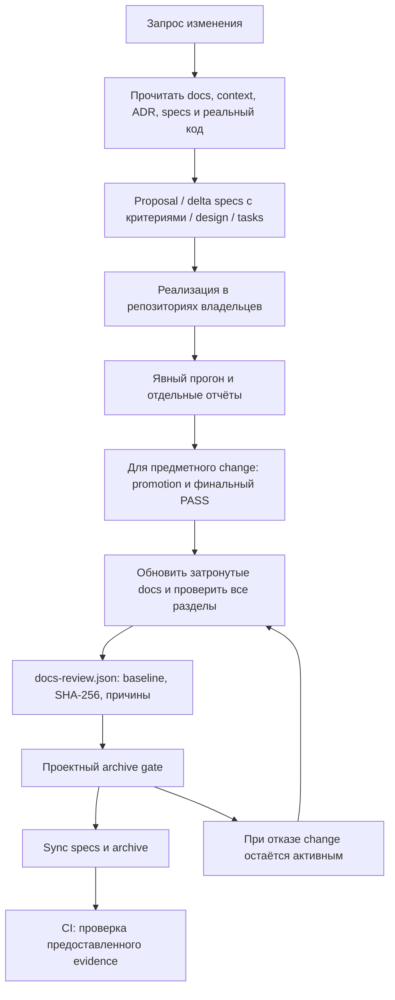

# Разработка, проверки и сопровождение документации

[Начало](README.md) · [Архитектура](architecture.md) · [Эксплуатация](operations.md)

## Источники требований и код

`tamarix-specs` — центральный store: specs, changes, контекст, ADR и это
руководство. Кодовые сервисы и TamarixTests содержат только `store: tamarix-specs`
в OpenSpec config. Собственные specs/changes там не создаются. TamarixCD
отдельно хранит planning доставки и своей инфраструктуры.

Перед работой прочитайте [AGENTS](../AGENTS.md),
[context index](../openspec/context/README.md) и применимые ADR. Текущие
предметные требования — в `openspec/specs`; pending change описывает будущую
дельту. Контекст хранит правила выбора и датированные решения, docs объясняет
текущее устройство, архив сохраняет историю и evidence.

## Как менять приложение

1. Найдите capability по [карте доменов](domains.md) и прочитайте requirements
   целиком. Опишите наблюдаемые acceptance criteria до реализации.
2. В design назовите изменяемый контракт, владельца данных, совместимость,
   зависимости и границы отказа. Для DDL прочитайте data context; миграции
   создаёт только db-control. Реализация TBD-решения требует его принятия.
3. Заведите небольшие задачи по репозиториям и точные Requirement/Scenario →
   test ID/node ID связи. Unit/component остаются у сервисов; межсервисные
   integration/e2e — в TamarixTests, orchestration — в TamarixCD.
4. Реализуйте код и проверки. Для всех тестов требуется русское описание:
   условия, наблюдаемый результат и назначение; в Python это docstring,
   для параметров нужны пояснения различий, для registry — также description.
5. Явно запустите нужный набор с отчётом. Прогон при fail/cancel тоже сохраняет
   отдельные результаты. Не перезаписывайте предыдущие каталоги.
6. Перед предметным archive проверьте traceability/коллекцию, новые случаи и
   текущий регресс, promotion, зафиксируйте окончательный tests commit и
   получите финальный полный PASS. Archive использует этот готовый отчёт.

Формат runner и promotion — [testing context](../openspec/context/testing.md)
и [TamarixTests](../../../TamarixTests/README.md). Способы подготовки manifest —
[эксплуатация](operations.md).

## Обязательное обновление docs перед archive

Правило действует для каждого нового change, включая tooling/docs-only,
single и bulk archive. Агент должен **сам внести изменения в руководство**
по фактически реализованному результату, затем проверить весь комплект.
Пользователю не требуется отдельно просить обновить документацию.

| Раздел | Что сверить при каждом change |
| --- | --- |
| README | Назначение, маршрут знакомства, статус готовности и ссылки |
| architecture | Общая схема, слои, доверие, транзакционные и runtime границы |
| domains | Словарь, lifecycle, identity, инварианты и примеры |
| services | Обязанности и зависимости, последовательности взаимодействий |
| api | Реальные операции, DTO, ошибки, примеры и совместимость |
| database | Назначение каждой таблицы, схемы, все столбцы/связи, ограничения, индексы, locks и данные-примеры |
| operations | Запуск, конфигурация, миграции, диагностика, восстановление |
| development | Тестирование, evidence и изменившийся процесс работы |

Для незатронутого раздела запишите `reviewed` и конкретное русское объяснение,
почему описание осталось верным. Для изменённого — `updated` и что обновлено.
Хотя бы одна Markdown страница должна действительно измениться относительно
baseline; смена только evidence не считается обновлением документации.
При изменении поведения поправьте объяснение и пример, а не только дату.
Для tooling уточните соответствующий процесс в development/operations.

`docs-review.json` хранит baseline commit, SHA-256 всех docs и входов change,
список фактически изменённых страниц и результаты обзора восьми разделов.
`docs-snapshot.json` сохраняет полный текст страниц с их SHA-256: архив можно
проверить после следующих обновлений руководства. Prepare формирует оба файла;
snapshot вручную не редактируется.
Baseline фиксируйте до редактирования документации и сохраняйте при повторном
review. Установка baseline на уже обновлённый docs commit скроет реальную дельту.
Точный CLI и формат — [tools/ARCHIVE_GATE.md](../tools/ARCHIVE_GATE.md).

Структурная проверка обнаруживает отсутствующие страницы, локальные битые
ссылки, пустые/незакрытые Mermaid blocks и устаревший evidence. Она не может
доказать, что объяснение точно отражает бизнес-смысл или что диаграмма удобна
для чтения. Содержание сверяйте с исходниками, схемы проверяйте Mermaid parser
и просмотром в Markdown viewer с поддержкой Mermaid.

Ссылки внутри docs/store проверяются строго. Межрепозиторные ссылки можно
разрешить полностью в совместном checkout; в store-only CI отсутствие
соседнего репозитория не является ошибкой внутренней навигации.

## Archive и CI

Запускайте check/archive через `tools/archive_gate.py` по
[инструкции](../tools/ARCHIVE_GATE.md). Обёртка должна проверить docs **до**
изменения specs/переноса change, затем применить прежние условия regression
evidence. Bulk обрабатывает каждый change последовательно; документация и
review обновляются в соответствии с конкретным change и порядком sync.
После изменения docs в следующем элементе batch прошлые hashes и текст остаются
историческим снимком, а evidence следующего должен отражать новые файлы.
CI отдельно проверяет каждый сохранённый snapshot и требует совпадения текущих
docs хотя бы с одним новым архивом. Git не задаёт порядок нескольких архивов
в одном commit; проверка не утверждает строгую хронологию внутри такого batch.
Уже принятые в base review/snapshot и их hash-поля неизменяемы.

Прямой `openspec archive` и ручной `mv` не обновляют документацию и обходят
локальный wrapper. CI новых архивов проверяет предоставленный documentation
evidence и выявляет такой обход. Required check зависит от branch protection;
его наличие в прежнем evidence не заменяет проверку policy нового remote.
Отдельный [workflow](../.github/workflows/archive-evidence.yml) выполняет
валидацию артефактов, не запускает предметный регресс.

При отсутствии/устаревании docs review change остаётся активным. Исправьте
текст, обновите hashes и повторите обзор. При устаревшем test report потребуется
явный согласованный прогон нужных версий. Не создавайте PASS искусственно.

Прежние архивы T-1/T-2/T-3 сохраняются без нового docs evidence задним числом.
Неизменённые исторические hashes не сравниваются с будущим руководством.
Обновление документации не переписывает старые исходники или историю ADR.

## Изменение самого руководства

Пишите по-русски, оставляя реальные имена DTO, путей, таблиц и API. Начинайте
с назначения элемента и примера использования, затем приводите детали.
Каждая техническая схема — fenced `mermaid`; указывайте, если стрелка означает
логическую зависимость, а связь ещё не реализована физически.
Данные-примеры должны быть вымышленными, согласованными по FK и пригодными
для объяснения constraints. Не добавляйте DSN, пароли, private Name DER
или реальные пользовательские сведения.

Ссылайтесь на актуальные исходники относительными путями; точные pins берите
из манифеста/lock, статус accepted — из ADR или явного решения. Не называйте
запланированный wire API готовым по имени `*-api`. Если требование и код
расходятся, зафиксируйте проблему; docs не подменяет исправление поведения.
