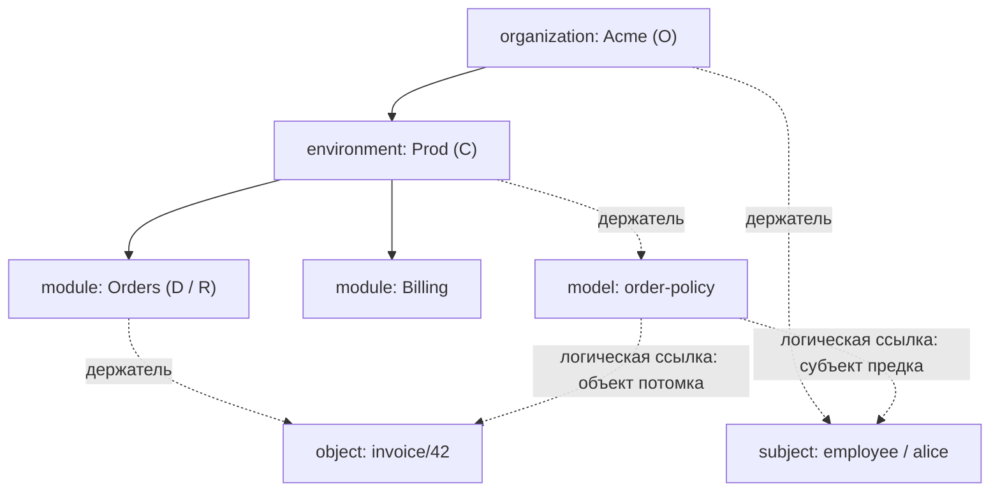

# Домены, термины и правила продукта

[Начало](README.md) · [Архитектура](architecture.md) · [API](api.md) · [База данных](database.md)

## Словарь

| Термин | Значение в Tamarix |
| --- | --- |
| Контейнер | Узел forest; область хранения и управления с собственным типом и key |
| Держатель | Единственный контейнер, которому принадлежит субъект, объект или модель |
| Владелец O | Вызывающий, подтвердивший сертификат и зарегистрированный DN в явно представляемом контейнере O |
| C | Адресуемый контейнер операции |
| D | Держатель изменяемой сущности/модели; для create-child — родитель, для изменения контейнера — сам контейнер |
| R | Держатель объекта проверки доступа |
| `A ≼ B` | A совпадает с B или является фактическим предком B |
| Субъект | Пользователь, сервис или иная сущность, для которой проверяется право; не обязательно вызывающий администратор |
| Объект | Идентифицируемый защищаемый ресурс; содержимое внешнего файла/документа Tamarix не хранит этим фактом |
| Модель | Логическая единица правил доступа с одним держателем; T-3 сохраняет только metadata |
| Атрибут | Типизированное свойство конкретного владельца по общему definition |
| Shape | Именованная immutable форма: тип, кратность, профиль и закреплённая версия сравнения |
| Definition | Предметная identity атрибута: id/key, точный shape_id и отдельная applicability |
| Revision | Версия агрегата для compare-and-swap, повышается при успешном логическом изменении |
| Fact | Сведения от явно заданного источника; DTO сам не подтверждает доверие к источнику |
| Complete / Unknown | Подтверждённая полнота / невозможность установить обязательный состав |
| Neutral / Undefined | Неприменимость или отсутствие определённого эффекта / неопределённый результат известной модели |

RBAC/ABAC/ReBAC обозначают направление продукта. Полноценные роли,
отношения/назначения и язык политик не реализованы самим наличием этих терминов.
PAP/PDP/PEP/PIP — роли в архитектуре авторизации; их определения и оставшиеся
вопросы находятся в [security context](../openspec/context/security.md).

## Карта capabilities

| Домен / capability | Что описывает | Где реализация |
| --- | --- | --- |
| [containers](../openspec/specs/containers/spec.md) | Forest, адресация, DN/admission, область управления и lifecycle | container-adm-api + db-control |
| entities / [subjects](../openspec/specs/entities/subjects/spec.md) | Типы субъектов, один держатель, identity, attrs, soft delete/restore | entity-subject-adm-api + db-control |
| entities / [objects](../openspec/specs/entities/objects/spec.md) | Защищаемые объекты, точная identity, attrs, hard delete | entity-object-adm-api + db-control |
| [attributes](../openspec/specs/attributes/spec.md) | Общие shapes, definition/applicability, typed values, scalar/set и comparison | Четыре admin-пакета + reader + db-control |
| access-model / [models](../openspec/specs/access-model/models/spec.md) | Постоянная identity и metadata моделей | policy-adm-api + db-control |
| authorization / [access-check](../openspec/specs/authorization/access-check/spec.md) | Субъект, scope, полный состав, агрегация T-1; snapshot T-3 | policy-decision-api |

`entities` и `access-model` группируют capabilities. Дерево specs не является
деревом сервисов или SQL-схем. Capability `project-documentation` нового change
относится к процессу store, не добавляет предметный домен авторизации.

## Пример: Acme и сервис Orders

У `Orders` нет искусственного родителя `system`: типы можно пропускать.
Адрес Orders — `{"organization":"Acme","environment":"Prod","module":"Orders"}`.
Объект `invoice/42` имеет holder Orders; субъект employee/alice — holder Acme.
Модель в Prod может логически ссылаться на такого субъекта и объект.
Пунктирные model references показывают правила T-1; T-3 не хранит таблицы
исполняемых ссылок, поэтому эта схема не является готовым SQL seed моделей.

Пусть проверенный DN зарегистрирован у O=Acme. При C=Prod можно управлять
данными D=Orders: `Acme ≼ Prod ≼ Orders`. Данные в Billing находятся в другой
ветке относительно Orders: обращение C=Orders не даёт ими управлять.
Заявить O=Acme недостаточно — DN должен соответствовать именно этому O.

## Контейнеры и адрес

Типы строго возрастают по порядку `organization → environment → system → module`.
Любой тип может быть root. У некорневого узла один parent; циклы и повтор типа
вдоль пути запрещены. Несколько roots и детей одного типа допустимы.

Ключ контейнера — ASCII `[A-Za-z0-9_-]`, 1–255 символов; равенство без учёта
ASCII регистра, исходное написание сохраняется. Уникальность root — `(type,key)`,
child — `(parent,type,key)`. Равные key у разных типов могут сосуществовать.
Полный адрес содержит все фактические узлы, порядок членов JSON не важен;
повторы имени типа обнаруживаются до создания `dict`.

BIGINT ID стабилен при rename. Переименование предка меняет вычисляемый адрес
потомка, но не его ID и собственную revision. Parent и тип существующего
контейнера не меняются; runtime не создаёт roots. Удаление не рекурсивно:
дети, активные субъекты, объекты и metadata моделей должны быть устранены
согласно DB-инвариантам; held tombstones удаляются при удалении holder.

## Субъекты, объекты и metadata моделей

| Свойство | Subject | Object | Model metadata |
| --- | --- | --- | --- |
| Natural identity | holder + type + key | holder + key | holder + key |
| Key | Unicode, 1–512 codepoints | Непустой Unicode без application max | ASCII `[A-Za-z0-9_-]`, 1–512 символов |
| Сравнение | Точное, без trim/casefold/нормализации | Точное; hash ищет кандидатов, полная строка решает равенство | Без учёта ASCII регистра; исходное написание сохраняется |
| Изменяемое состояние | Attributes, deleted_at | Attributes | Attributes |
| Identity/holder | Неизменяемы | Неизменяемы | Неизменяемы |
| Удаление | Soft delete; natural key зарезервирован | Hard delete + свои attrs | Hard delete + свои attrs |
| Восстановление | Прежний ID и attrs через restore | Не реализовано | Не реализовано |

Все keys исключают Cc и невалидный UTF-8. Subject types — общий каталог,
а не свободное значение клиента. Active чтение не показывает tombstones;
admin чтение сохраняет доступ к deleted_at и attributes. Создание того же
subject key при tombstone возвращает `RestoreRequired`.

Ссылка другой модели не переносит субъекта/объект/модель к другому держателю.
В T-1 модель держателя M может ссылаться на субъект из M/предков и объект
из M/потомков. Persistent хранение непустых model refs и их атомарная очистка
при удалении ещё не реализованы и требуют отдельного change.

## Атрибуты и DN

Catalog operator регистрирует именованный immutable shape с native type,
cardinality и закреплённым comparison; затем definition со своим key и точным
shape_id и его явную applicability к типам контейнеров, субъектов, объектов или
моделей. Несколько definitions могут явно выбрать одну форму; одинаковые
параметры двух отдельно именованных форм не объединяют их автоматически. Владелец контейнера не получает
глобальное право менять эти каталоги.

Instance связывает definition с одним owner и закрепляет его точный shape.
Любой instance, даже empty set или retained tombstone, запрещает rebind definition.
Сам shape immutable с момента регистрации, включая key; новая семантика требует
отдельной формы. Key — ASCII 1–512, глобально ASCII-CI unique; это имя выбора,
а не плавающая ссылка на latest. UI и будущие regex/range rules не реализованы.

Instance хранит structural copies типа и кратности. Scalar требует ровно одно
значение; set не упорядочен и устраняет равные элементы по профилю сравнения.
Отсутствующий attribute, существующий пустой set и `null` — разные случаи:
первые два разрешены по своей семантике; `null` не является значением.
Типы: `string`, `integer`, `decimal`, `boolean`, `date`, `instant`
(timezone-aware datetime), `dn`. Полное физическое
представление, profiles и примеры — в [database.md](database.md).

DN — set атрибут контейнера с `x509_rfc5280`, а не отдельная таблица bindings.
Проверяется Name DER доверенного certificate fact у явно указанного O и
конфигурированного definition ID. Codec/Unicode tables/version поставляет
db-control; текстовое сравнение строк DN не заменяет это соответствие.
Удаление DN из set или Unset снимает данную привязку. Это admission
администратора, отдельно от identity субъекта проверки доступа.

## Проверка доступа T-1

1. Разрешить C/O, подтвердить certificate/DN и обязательные entity-факты.
2. Проверить `C ≼ R` для держателя объекта. Общей привязки субъекта к C нет.
3. Установить весь путь от root до R, включая предков C, и полный набор
   моделей каждого контейнера пути, в том числе явные пустые наборы.
4. Применить каждую известную модель в области её субъекта. Для holder модели M
   условие применимости — holder субъекта совпадает с M или является его предком.
5. Объединить эффекты правил внутри модели, затем результаты моделей.

| Состояние | Итог |
| --- | --- |
| Невозможно установить полный путь/состав моделей | Deny, даже при известном частичном Allow |
| В полном составе есть Deny | Deny |
| В полном составе есть Allow, запретов нет | Allow; Neutral/Undefined этому не мешают |
| Только Neutral/Undefined или подтверждённо пустой состав | Deny по умолчанию |
| Модель вне области субъекта | Neutral для этой модели |
| Недопустимый запрос/неуспешный admission | Отдельный rejection до вычисления |
| Недоступны обязательные entity-факты | Отдельная ошибка фактов, не Undefined известной модели |

Так нельзя обойти запрет в Acme, адресовав запрос непосредственно Orders:
модели предков C всё равно входят в путь. Нельзя заменить неизвестный набор
пустым, а snapshot metadata — набором исполненных моделей.

## Revision и атомарность T-3

Создание задаёт revision 1. Изменение требует первоначальную `expected_revision`;
успешная логическая мутация увеличивает revision агрегата ровно на один.
No-op с актуальным token даёт `Unchanged`; stale token даёт конфликт даже
для пустого изменения. Замена set переставленными равными значениями не меняет
состояние; case-only rename контейнера меняет сохранённое написание.

Admission, scope, CAS и attrs одной команды входят в одну SERIALIZABLE transaction.
Откатившийся serialization/deadlock повторяет всю команду до трёх попыток,
с исходным expected. Неизвестный commit требует выяснения состояния;
автоматическая подстановка новой revision нарушила бы обещание CAS.

Источник нормативной семантики — основные specs из таблицы capabilities;
источники исполнения — [services.md](services.md), [api.md](api.md),
[database.md](database.md) и [контракты T-3](../openspec/changes/archive/2026-10-15-t-3-persistent/storage-contracts.md).
