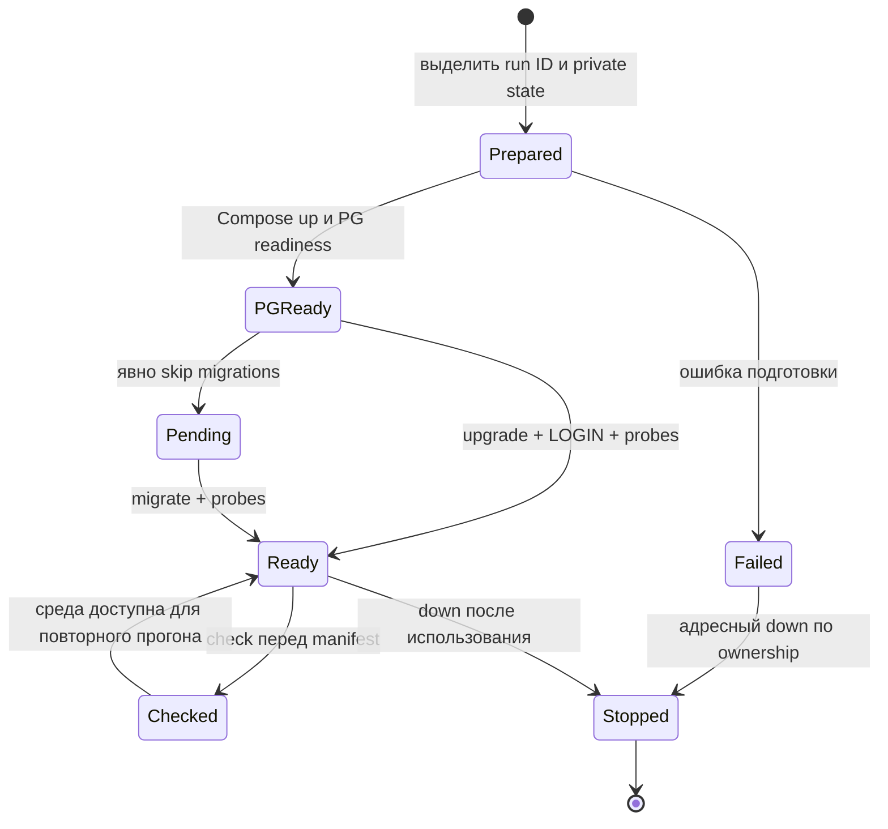

# Запуск, проверка среды и диагностика

[Начало](README.md) · [API](api.md) · [База данных](database.md) · [Разработка](development.md)

## Рабочий checkout

Команды ниже рассчитаны на такую структуру; пути относительны к указанному
перед примером репозиторию и не зависят от домашнего каталога разработчика:

```text
TamarixS/
├── Tamarix/
│   ├── tamarix-specs/
│   ├── container-adm-api/
│   ├── entity-subject-adm-api/
│   ├── entity-object-adm-api/
│   ├── policy-adm-api/
│   ├── policy-decision-api/
│   ├── db-control/
│   └── access-assignment-api/
├── TamarixCD/
└── TamarixTests/
```

Сначала проверьте `.python-version`, `pyproject.toml`, `uv.lock` нужного пакета.
Текущий принятый Python — 3.15.0 final, uv — 0.12.24. Установка каждого
нужного Python-проекта из его корня:

```sh
uv lock --check
uv sync --frozen
```

Если установлен другой uv, существует изолированный launcher
`uv tool run --from uv==0.12.24 uv <команда>`.
Не запускайте `uv lock` только ради установки: он может изменить pins.
Latest stable — политика согласованного обновления, не плавающие версии среды.

## Development HTTP-процессы

Нужны Docker Desktop, context `desktop-linux`, Compose/BuildKit с named build
contexts, Git и host Python >=3.9. В корне `TamarixCD`:

```sh
./deploy.sh validate
./deploy.sh up
./deploy.sh status
./deploy.sh verify
./deploy.sh logs
```

`up` берёт **закоммиченные** исходники всех пяти сервисов из локальных `main`,
готовит отдельные снимки, собирает образы и ждёт health. Незакоммиченная правка
в соседнем `src` в образ не попадёт. Выбор ветки задаётся явно:

```sh
./deploy.sh up --service-branch container-adm-api=feature/my-change
```

Для общей ветки всех сервисов используется `--branch NAME`; per-service выбор
имеет приоритет. Другой checkout сервисов задаётся `TAMARIX_WORKSPACE`.
Команда собирает все пять сервисов; параметр branch только меняет источник.
`build` собирает образы, `up` также запускает; `down` останавливает этот Compose
project. Параметры context/project — `TAMARIX_DOCKER_CONTEXT` и
`TAMARIX_COMPOSE_PROJECT`. Значения по умолчанию — `desktop-linux`, `tamarix-local`.

| Сервис | Host endpoint |
| --- | --- |
| container-adm-api | `http://127.0.0.1:8101/health` |
| entity-subject-adm-api | `http://127.0.0.1:8102/health` |
| entity-object-adm-api | `http://127.0.0.1:8103/health` |
| policy-adm-api | `http://127.0.0.1:8104/health` |
| policy-decision-api | `http://127.0.0.1:8105/health` |

```sh
curl --fail http://127.0.0.1:8101/health
```

Успех означает `status=ok`, ожидаемый `service`, `scope=development` и верный
`launch_id`. Новый launch ID отличает свежую раскатку от старого процесса.
`artifacts/deployment.json`, `launch-id` и verification связывают запуск с Git
снимками. Это проверка импорта логического ядра и HTTP-процесса. Compose здесь
не подключает persistent application services к DB и не объявляет бизнес REST.

Источники: [deploy.sh](../../../TamarixCD/deploy.sh),
[Compose](../../../TamarixCD/compose.yaml),
[runtime](../../../TamarixCD/runtime/README.md).

## Отдельная PostgreSQL integration-среда

Она создаётся независимо от пяти HTTP-контейнеров, с уникальными project,
volume, database, run ID и динамическим loopback port. DDL и LOGIN поставляет
db-control. В корне `TamarixCD`, после frozen подготовки db-control:

```sh
python3 ci/postgresql_environment.py prepare \
  --output-dir reports/postgresql \
  --secrets-file /private/tmp/tamarix-pg-private-UNIQUE.json \
  --db-control ../Tamarix/db-control \
  --migration-python ../Tamarix/db-control/.venv/bin/python
```

Замените `UNIQUE` новым именем для каждого prepare. Путь state печатается
командой; сохраните его. Private JSON создаётся эксклюзивно с mode 0600 вне
каталога отчётов. Он содержит DSN/пароли для admin и шести отдельных actors.
Public `results.json` содержит имена env и несекретные факты образа/БД.
Не копируйте private JSON в evidence или Git.

```sh
python3 ci/postgresql_environment.py check --state /absolute/path/run/results.json
python3 ci/postgresql_environment.py migrate \
  --state /absolute/path/run/results.json \
  --db-control ../Tamarix/db-control \
  --migration-python ../Tamarix/db-control/.venv/bin/python
```

`prepare` обычно применяет миграции и provision-test-logins. Отдельный
`--skip-migrations` даёт лишь `PG_READY_MIGRATIONS_PENDING`: такой state
непригоден для предметного manifest. `READY` требует реальные LOGIN и
согласованные heads/resource hashes/migration fingerprint. Выбор `SET ROLE`
на admin connection не заменяет проверку отдельных LOGIN.



После работы из `TamarixCD`:

```sh
python3 ci/postgresql_environment.py down --state /absolute/path/run/results.json
```

Это адресная очистка ресурсов данного run с проверкой ownership. Private file
удаляется отдельно после использования. Глобальные prune и очистка чужих
projects не являются частью процедуры.
Подробный контракт — [EXTERNAL_TESTS.md](../../../TamarixCD/ci/EXTERNAL_TESTS.md).

## Переход на неизменяемые формы T-5

Head db-control `20261016_0004` следует за `20261015_0003`; номера historical
revisions не заменяют hashes SQL/data из artifact-info. Приведённый ниже порядок
относится к подготовке upgrade, а не к подтверждённой production поставке.

1. Зафиксировать deployed head/artifact hashes и данные сравнения: definitions
   tuple, IDs/key, applicability, instances/values, aggregate revisions,
   mutation_version, DN DER/keys, column signatures/ACL опубликованных views.
2. До deployment определить maintenance window, допустимые lock/statement budgets,
   measured data volume и проверенный backup/PITR recovery runbook. Upgrade
   использует lock_timeout=10s по умолчанию; другой бюджет задаётся через Alembic
   config.attributes["shapes_lock_timeout"], отдельного CLI флага нет.
   statement_timeout migration не устанавливает. Учитывать длительные readers:
   ACCESS EXCLUSIVE locks owner tables, definitions, четырёх applicability/instance/
   value families конфликтуют и с SELECT. Они стабилизируют snapshot для
   внутренней проверки fingerprints. Остановить
   приём новых domain/catalog writes и дождаться drain активных transactions.
3. Выполнить upgrade отдельным deployment executor. В одной transaction создаются
   immutable shapes, каждому старому definition назначается отдельный
   migrated_definition_<id>, сохраняющий точную comparator version. Backfill
   не пересчитывает payload/DN и не увеличивает revisions/mutation_version.
4. Migration исполняет накопленные deferred scalar checks перед ALTER TABLE,
   ставит новые FK/NOT NULL/guards, меняет routines/views/ACL и лишь затем
   удаляет старые semantic copies. До commit Python revision сравнивает SHA-256
   fingerprints прежних facts/payload/aggregate rows/applicability/comparison registry
   с исходным снимком; mismatch прерывает upgrade без вывода значений. Отдельный
   CLI fingerprint report не создаётся. Timeouts/ошибка откатывают весь upgrade;
   частично готовая схема не публикуется.
5. Сверить до/после fingerprints и map definition→shape, exact view signatures,
   старые commands/readers и DN admission. После commit и operational checks
   возобновить writers; сохранить actual head/resource hashes в manifest.

При lock timeout диагностировать долгие transactions и повторять всю migration
после устранения причины. Нельзя отключать FK/guards для продолжения неполного
backfill. После commit старые совместимые consumers продолжают работать;
устранение дефектов выполняется fix-forward либо отдельным recovery-планом.

Обратный переход 0004→0003 через Alembic API предназначен только для disposable
tamarix_t3_* с явным safeguard: старые columns восстанавливаются из shapes,
deferred checks выполняются до ALTER, затем возвращаются guards/routines/views/FK
и снимаются shape dependencies. Shape ID/key/sharing при этом теряются. CLI
downgrade по-прежнему идёт до base и уничтожает тестовую схему. Он не является
production rollback; восстановление backup без учёта последующих writes
не обещает сохранение этих writes. Практическая готовность backup/PITR/HA этим
runbook не подтверждается.

Реализация/ограничения: [схема и миграции](database.md#13-миграции-первичный-root-и-откат),
[db-control README](../../db-control/README.md),
[ADR 0005](../openspec/context/adr/0005-immutable-shared-attribute-shapes.md).

## Явный запуск предметного регресса

Тесты не стартуют от `up` или archive. Для `TamarixTests` заранее выполните
frozen установку; фиксируйте исходники во всех задействованных Git checkout.
Из корня `TamarixCD` запустите текущий PostgreSQL-регресс:

```sh
python3 ci/external_tests.py run \
  --workspace ../Tamarix --tests ../TamarixTests \
  --store ../Tamarix/tamarix-specs --regression \
  --scope postgresql-integration \
  --postgresql-state /absolute/path/run/results.json \
  --db-control ../Tamarix/db-control \
  --runner-python ../TamarixTests/.venv/bin/python \
  --output-dir /private/tmp/tamarix-pg-runs --junit
```

Для будущего предметного change вместо `--regression` выбирают
`--change CHANGE`: runner включает его случаи и текущий регресс. Диагностику
можно ограничить `--id CASE_ID` или `--level integration`; выборочный прогон
не подтверждает готовность archive. `logical-integration` проверяет ядра,
`postgresql-integration` — реальные SQL-границы, `http` — HTTP scope;
предметный HTTP e2e ещё требует самих бизнес endpoints.

Каждый run получает собственный каталог с русской `summary.md`, JSON, manifest
и логами; JUnit добавляется по флагу. CD orchestration report и case report
runner различаются: gate принимает **results.json runner**, содержащий test IDs
и результаты случаев. `complete:false`, SKIP/XFAIL/NOT_RUN и ошибки среды
не превращаются в PASS. Подробнее — [TamarixTests README](../../../TamarixTests/README.md).

## Симптом → проверка → действие

| Симптом | Что проверить | Следующее действие |
| --- | --- | --- |
| Health не отвечает | status/logs, port, context и launch_id | Исправить импорт/конфигурацию и повторить согласованную раскатку |
| Health PASS, business URL даёт 404 | Реальный [API](api.md) | Использовать Python contract; business endpoints пока не реализованы |
| Изменения кода не видны | Ветка и commit в sources/deployment manifest | Закоммитить нужные исходники и выбрать правильную service branch |
| Manifest отклонён как stale | Чистота Git, installed source hashes, migration artifact | Зафиксировать согласованные версии, frozen setup и новый manifest |
| DB пишет privilege denied | LOGIN/current_user и назначенная группа | Использовать правильный actor; runtime не должен писать base tables напрямую |
| RevisionConflict | Переданный expected и текущее состояние агрегата | Перечитать данные, согласовать изменение; не подменять expected внутри повтора |
| RetryExhausted | Конкуренция guard rows, длительность transactions | Диагностировать блокирующие операции; новый вызов выполнять осознанно |
| CommitOutcomeUnknown | Состояние соединения и наблюдаемое состояние после reconnect | Выяснить результат операции до повторного create/delete |
| FactsUnavailable | Наличие view/grants, соединение, actual migration head | Восстановить источник; пустые данные не являются заменой ошибки |
| RestoreRequired | Tombstone субъекта с прежней identity | Использовать restore прежнего ID/revision |
| Shape UPDATE отвергнут | Неизменяемость всей формы, включая unused | Регистрировать новую форму; используемый definition не перепривязывать |
| bind_unused_shape отвергнут | Любые instances/empty sets/tombstones либо DN applicability | Проверить точный pin и зарегистрировать новое definition для новой семантики |
| Archive gate отказал | docs-review, report selection/hashes/commits/promotion | Обновить docs/evidence либо явно выполнить нужную проверку |

SQL-запросы для locks и целостности, причины `23505/23514/40001/40P01`
и границы отката находятся в [database.md](database.md).

## Эксплуатационные границы

Существующая среда — development/integration. Production backup/restore,
HA/репликация, SLO/алерты, аудит/retention и управление секретами ещё не
описаны как реализованный контур. При подготовке production их требуется
спроектировать отдельным change. Alembic downgrade для disposable данных
не является процедурой восстановления рабочей БД. После полезных записей
нужен план forward-fix или проверенное восстановление из backup.
