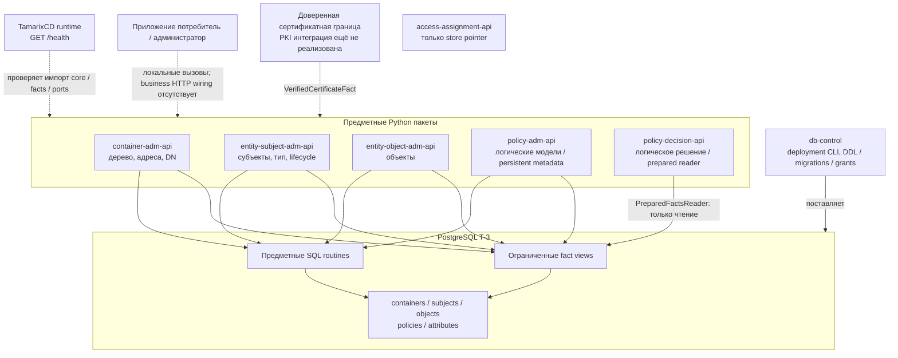
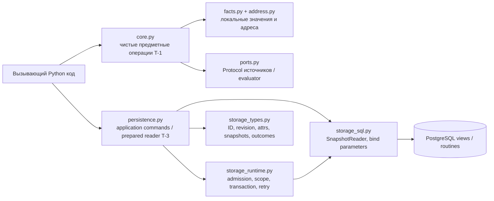
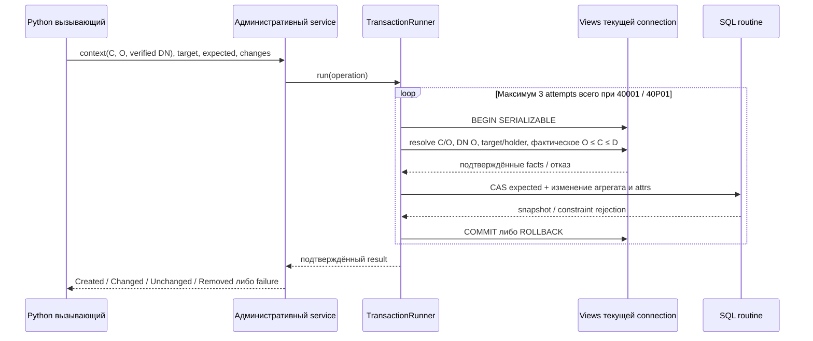
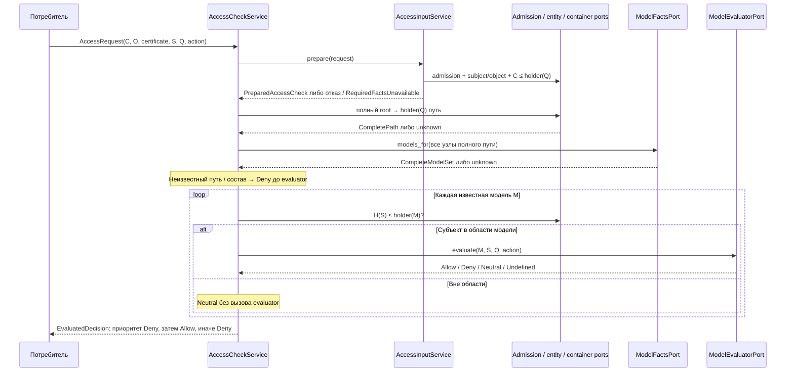

# Сервисы, слои и взаимодействия

Состояние описано по исходникам на 2026-10-15 после T-1 и T-3. Для первого
знакомства начните с [общего устройства](architecture.md), затем прочитайте
[контракты API](api.md) и [устройство БД](database.md).
Ниже «сервис» обозначает предметную ответственность и Python-пакет. Наличие
`*-api` в имени само по себе не означает доступный бизнес endpoint.

## Карта компонентов

Сплошные связи с БД отражают реализованные T-3 адаптеры. Пунктир у
вызывающего и доверенной границы показывает необходимое прикладное подключение,
которого HTTP runtime пока не выполняет. Между сервисами нет реализованной
сети REST-вызовов, брокера или общей библиотеки DTO. Логические зависимости
между источниками фактов реализуются локальными портами и явными адаптерами;
T-3 читает разрешённые DB views в общей транзакции.

## Ответственность каждого компонента

| Компонент | Что делает | Данные и зависимости | Текущая граница |
| --- | --- | --- | --- |
| `container-adm-api` | Проверяет лес контейнеров и типы, разрешает составные адреса, устанавливает фактическое родство и полный путь, подтверждает зарегистрированный DN явного O; T-3 создаёт дочерние узлы, меняет key/attrs, удаляет узел | Авторитетные `containers`; DN хранится в container attributes; SQL reader и write routines | Root создаёт отдельный privileged executor. Нет runtime create-root, PKI, рекурсивного delete или перемещения parent/type |
| `entity-subject-adm-api` | Предоставляет исходный субъект и единственного держателя; T-3 создаёт субъекта, меняет attrs, выполняет soft delete/restore, разделяет active/admin read | `subjects`, общий каталог типов и применимых definitions; факты containers/DN | Субъект не является владельцем O автоматически. Holder/type/key неизменяемы; soft delete сохраняет ID и attrs; purge только с держателем |
| `entity-object-adm-api` | Предоставляет исходный объект и держателя; T-3 создаёт объект с точным произвольным Unicode key, меняет attrs, физически удаляет | `objects`, attributes, факты containers/DN | Сервис не хранит содержимое внешнего защищаемого ресурса. Holder/key неизменяемы; повтор удаления не обещает идемпотентный успех |
| `policy-adm-api` | T-1 проверяет держателя и статические ссылки логической модели, выдаёт полный набор моделей контейнеров. T-3 управляет только metadata и attrs | В T-1 читающие entity/container ports. В T-3 `policies.models` / `policies.model_metadata_facts`, attributes, container/DN views | `ModelRecord.content` и `ModelReferences` не сериализуются в БД; persistent metadata не исполнимая политика |
| `policy-decision-api` | T-1 собирает полный путь и модели и вычисляет результат. T-3 отдельно материализует prepared snapshot из одной read-only транзакции | Admission, entity/container/model facts и evaluator через T-1 ports; T-3 прямые разрешённые DB views | Reader не подключён к `AccessCheckService`; persistent evaluator и полный persistent PDP отсутствуют |
| `db-control` | Единственный владелец DDL, Alembic revisions, SQL functions, triggers, views, grants и versioned comparison codecs | PostgreSQL; вызывается deployment executor; поставляет контракт хранилища пяти пакетам | Deployment-only инструмент. Предметные сервисы не отправляют в него CRUD-команды и не запускают миграции |
| `access-assignment-api` | Зарезервированный компонент установленного состава | Найден только [указатель store](../../access-assignment-api/openspec/config.yaml) | Исходников, Python-пакета, HTTP routes и реализованного lifecycle назначений нет. Назначать ему RBAC/ReBAC обязанности по имени нельзя |
| `TamarixCD` | Подготавливает и запускает выбранные пакеты, среду БД и внешний runner; предоставляет общую HTTP оболочку разработки | Отдельные конфигурация и runtime dependencies; библиотеки сервисов устанавливаются отдельно | `GET /health` проверяет процесс и импорт ядра. Он не выполняет business commands, не открывает БД и не проверяет PKI |
| `TamarixTests` | Межсервисные integration/e2e, registry с постоянными ID, регресс, reports и evidence | Подготовленная среда CD, реальные пакеты и проверяемые публичные контракты | Unit/component остаются в сервисах. Health-check не доказывает предметное e2e |

Точки входа для чтения кода: [container README](../../container-adm-api/README.md),
[subject README](../../entity-subject-adm-api/README.md),
[object README](../../entity-object-adm-api/README.md),
[policy administration README](../../policy-adm-api/README.md),
[decision README](../../policy-decision-api/README.md),
[db-control README](../../db-control/README.md),
[CD README](../../../TamarixCD/README.md),
[Tests README](../../../TamarixTests/README.md).

## Как устроен Python пакет

| Модуль / слой | Ответственность | Что полезно помнить |
| --- | --- | --- |
| `address.py` | `ContainerType`, `AddressSegment`, `CompositeKey`, duplicate-aware JSON parsing и ASCII CI comparison | Валидная форма адреса ещё не доказывает существование узла или фактическое родство |
| `facts.py` | Локальные refs, immutable facts и различимые результаты T-1 | `UnknownPath`, пустой полный набор и `Undefined` известной модели имеют разный смысл |
| `ports.py` | Python `Protocol` источников фактов, admission и evaluator | Это точки подстановки адаптеров, без обещания REST/gRPC; типы соседнего пакета преобразуются явно |
| `core.py` | Проверки и алгоритмы T-1: дерево, область управления, ссылки, сборка цепочки, операторы | Не управляет SQL транзакцией. Старое `save(...)->None` нельзя считать транзакционным T-3 контрактом |
| `storage_types.py` | Положительные BIGINT IDs/revision, typed attrs, материализованные snapshots и безопасные outcomes | Каждый пакет определяет собственные классы; `ContainerId` из subject-пакета не является `ContainerId` container-пакета |
| `persistence.py` | Команды агрегата и чтение T-3; repository работает на переданной connection | Успех команды выдаётся после подтверждённого commit. DTO наружу не содержат lazy ORM объектов |
| `storage_runtime.py` | В четырёх административных пакетах: ManagementAdmission, scope, SERIALIZABLE write runner, READ ONLY RR read runner и отображение ошибок | В decision-пакете этого файла нет: `PreparedFactsReader` самостоятельно задаёт read-only snapshot boundary |
| `storage_sql.py` | Чтение разрешённых views, восстановление полного пути, typed attrs, native composite input для write routines | Не создаёт schema и не выполняет самостоятельный commit; все части attempt используют одну connection |
| `tree_adapter.py` | Только container-пакет: `PostgresContainerFacts` преобразует DB snapshots в локальные T-1 факты | Не открывает транзакцию; сохраняет complete/unknown и явное Ref↔ID преобразование |
| CD `runtime/app.py` | Выбирает установленный пакет, проверяет импорт, объявляет `/health` | Не вызывает persistent service constructors и не подключает бизнес endpoints |

Точное расположение слоёв видно, например, в
[container source](../../container-adm-api/src/container_adm_api/),
[policy source](../../policy-adm-api/src/policy_adm_api/) и
[decision source](../../policy-decision-api/src/policy_decision_api/).
Это описание обнаруженной структуры; названия Clean Architecture/DDD здесь
не объявляются отдельными принятыми архитектурными решениями.

## Административная команда: допуск и запись вместе

`O` — представляемый контейнер; `C` — адресуемый контейнер; `D` — держатель
изменяемой сущности. `A ≼ B` означает «A совпадает с B или является его
фактическим предком». Для existing container `D` — сам контейнер, для
create-child `D` — parent. Сертификатный факт поступает от доверенной внешней
границы. Дополнительная административная роль для владельца O не нужна.

При нарушении admission/scope, stale revision или инвариантов запись не
подтверждается. Retry повторяет весь attempt после доказанного rollback;
исходный expected token сохраняется. `CommitOutcomeUnknown` означает, что
исход commit неизвестен: автоматического слепого повтора нет. Подробности
CAS, ошибок и восстановления приведены в [API](api.md) и
[разделе о БД](database.md).

Административное чтение использует тот же admission/scope, но одну
`READ ONLY REPEATABLE READ` транзакцию. `policy-adm-api.metadata_for` —
такое административное чтение; его область управления каждым контейнером
не нужно переносить на будущий PDP reader.

## Логическая проверка доступа T-1

Следующая схема отражает исполнимый Python алгоритм с поставщиками фактов,
а не уже развёрнутую цепочку HTTP сервисов.

Полный путь включает предков C и оба конца, даже при `C = holder(Q)`.
У контейнера без моделей должен быть явный пустой group; отсутствие group —
unknown. Для access-check нет management-ограничения `O ≼ C` и общего
ограничения `H(S) ≼ C`. Права владельца O не разрешают действие субъекта S.

Статические ссылки при управлении логической моделью проверяются отдельно:
субъект допустим при `H(S) ≼ holder(M)`, объект — при
`holder(M) ≼ H(Q)`. Читающие entity ports не записывают новые держатели;
один subject/object сохраняет исходного держателя при любом числе ссылок.

## Prepared reader T-3: один согласованный снимок

`PreparedFactsReader` открывает `READ ONLY REPEATABLE READ` до первого SELECT,
в одной connection разрешает C/O, проверяет DN, читает active subject/object,
полный путь, container attrs и metadata каждого узла. Субъект и O могут быть
в другом дереве; нужные container snapshots добавляются без дубликатов.
Результат материализуется до закрытия транзакции.

Это готовая граница получения фактов для следующего этапа. В текущем T-3
metadata содержит только ID/holder/key/revision/attrs. Нет model content,
внутренних references, privileges/actions и evaluator. Поэтому
`ModelMetadataSet` нельзя преобразовывать в `CompleteModelSet` или объявлять
его `Undefined` модели; reader не возвращает Allow/Deny. Полный persistent
decision flow требует согласованного хранения исполнимых моделей и
атомарного cleanup входящих ссылок с revision затронутых моделей.

## Практические границы готовности

| Наблюдение | Как его понимать |
| --- | --- |
| `/health` вернул `status=ok` | Процесс CD runtime жив, имя сервиса/launch ID подтверждены, `core/facts/ports` импортировались |
| Миграции в актуальном `head` | Схема установлена; это ещё не проверка корректного DSN/полномочий каждого запущенного сервиса |
| Административный Python вызов вернул `Changed` | Commit соответствующей T-3 команды подтверждён; проверены admission, scope, CAS и инварианты этой команды |
| Prepared reader вернул snapshot | Факты и metadata согласованы в одном снимке; итоговый доступ ещё не вычислен |
| T-1 `AccessCheckService` вернул Allow | Полнота и модельные исходы подтверждены предоставленными адаптерами; реальность PKI/production источников зависит от их реализации |

Остаются открытыми business HTTP contracts, wire errors/versioning,
техническая PKI/transport trust, AuthZEN profile, модельные content/evaluator,
PEP для защищаемого ресурса, назначения, аудит, production SLO и эксплуатационная
топология. Реализованные SQL гарантии не снимают эти границы.

Основания: [ADR 0001](../openspec/context/adr/0001-t1-service-boundaries-and-admission.md),
[ADR 0002](../openspec/context/adr/0002-t1-logical-core.md),
[ADR 0003](../openspec/context/adr/0003-t1-python-environment-and-contracts.md),
[storage contracts T-3](../openspec/changes/archive/2026-10-15-t-3-persistent/storage-contracts.md)
и указанные выше исходники. Некоторые обзорные context-файлы сохраняют
исторические формулировки «persistence TBD»; при изучении текущей реализации
сверяйте их с T-3 и кодом.
